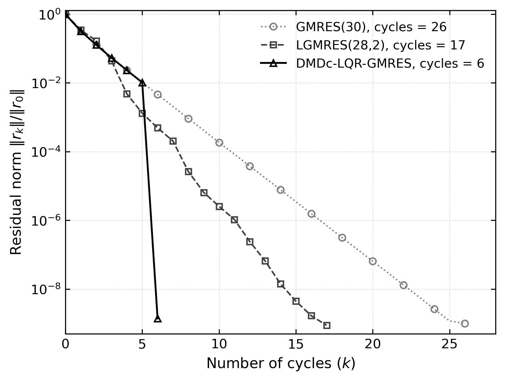
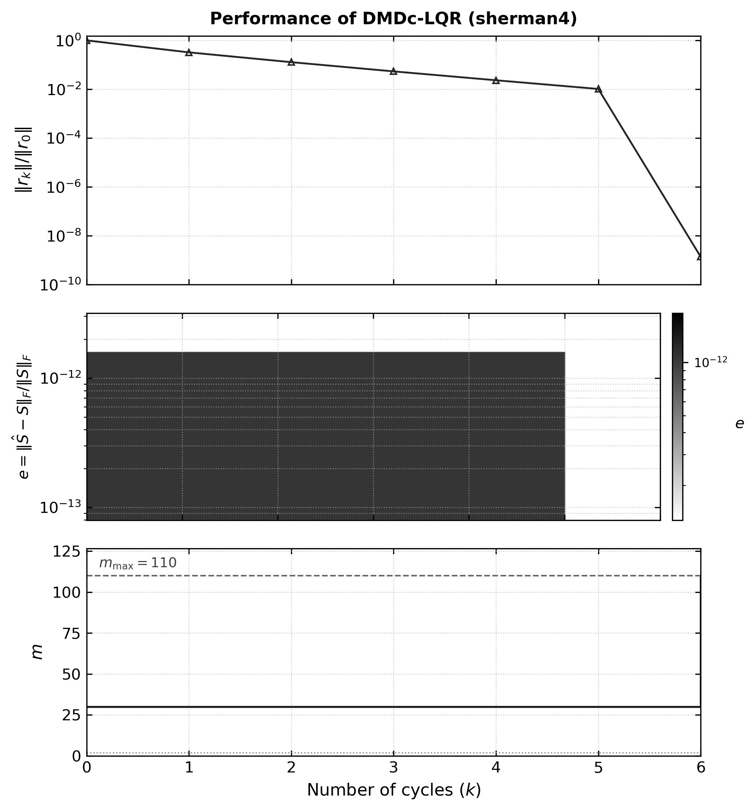

# DLK-rest: Solvers Krylov con Reinicio Adaptativo (DMDc-LQR) en PETSc

[](https://en.wikipedia.org/wiki/C11_(C_standard_revision))
[](https://petsc.org/)
[](https://www.open-mpi.org/)
[](http://www.netlib.org/lapack/)
[](LICENSE)

Implementación nativa, modular y de alto rendimiento en **PETSc (C / MPI)** de la familia de solucionadores de subespacios de Krylov con reinicio adaptativo basados en control óptimo y modelado reducido impulsado por datos, correspondiente a la investigación:

> **"Optimal Control for Restarting Minimal Residual Krylov Solvers via Data-Driven Residual Dynamics"**  
> *Carlos Benitez, Juan C. Cabral, Christian E. Schaerer.*

---

## 1. Motivación y Fundamento Teórico

El método de residuo mínimo generalizado con reinicio, **$\text{GMRES}(m)$**, enfrenta un dilema fundamental en sistemas lineales de gran escala $A x = b$:
* **Valores pequeños de $m$:** Bajo coste computacional y de memoria por ciclo, pero alto riesgo de **estancamiento severo** o convergencia lenta.
* **Valores grandes de $m$:** Mayor probabilidad de convergencia, pero a costa de un **crecimiento cuadrático en ortogonalizaciones** y almacenamiento en memoria ($m$ vectores de dimensión $N$).

### La Solución DLK (Dynamic Mode Decomposition with Control)
En lugar de fijar un parámetro estático $m$ o recurrir a heurísticas ad-hoc, el método **DLK**:
1. Recolecta una ventana deslizante de $p$ snapshots normalizados del residuo $r_k = b - A x_k$.
2. Aplica **DMDc (Dynamic Mode Decomposition with Control)** para identificar un modelo lineal en espacio de estados de orden reducido:
   $$\hat{x}_{k+1} = \bar{H} \hat{x}_k + \bar{B} u_k$$
   donde la variable de control $u_k = m_k$ es la dimensión del subespacio Krylov para el siguiente ciclo.
3. Resuelve una **Ecuación Algebraica de Riccati en Tiempo Continuo (CARE)** mediante el formalismo LQR sobre el subespacio controlable:
   $$\bar{H}^T P + P \bar{H} - P \bar{B} R^{-1} \bar{B}^T P + Q = 0, \quad K = R^{-1} \bar{B}^T P$$
4. Selecciona de forma óptima y adaptativa el parámetro de reinicio $m_{k+1}$ acotado en $[m_{\min}, m_{\max}]$, rompiendo mesetas de convergencia con el menor coste computacional.

El paquete implementa tanto la variante estándar **`DLK-GMRES`** como la variante enriquecida con aproximaciones de error acumuladas **`DLK-LGMRES`**.

---

## 2. Componentes del Repositorio

* **`src/` e `include/`**: Implementación nativa del solver KSP (`kspdlk.c`), rutinas de identificación DMDc y solución de Riccati (CARE) en C (`dmdc_lqr.c`), y encabezados públicos de PETSc (`petsckspdlk.h`).
* **`data/`**: Colección de 22 matrices SuiteSparse y sus binarios optimizados en `data/bin/`, junto con el script de conversión `convert_mat_to_bin.py`.
* **`scripts/`**: Automatización del benchmark comparativo (`run_all_22_benchmark.py`), driver de prueba de `sherman4` (`run_sherman4_experiment.py`) y generación de figuras para publicación (`plot_benchmark_bars.py`, `plot_comparison_of_methods.py`, `plot_performance_with_m.py`).
* **`tests/`**: Driver de validación y benchmarking `test_dlk.c`.
* **`results/`**: Tablas experimentales en `results/tables/` (`matrix_info.csv`, `cycles_experiment.csv`, `avg_relativa_time_experiment.csv`) y figuras vectoriales en `results/figures/`.

---

## 3. Requisitos y Compilación

### Requisitos del Sistema
* **Compilador C:** GCC 9+ / Clang 11+ compatible con C11.
* **PETSc:** Versión 3.20 o superior configurada con soporte para números reales (`--with-scalar-type=real`).
* **Librerías BLAS/LAPACK:** OpenBLAS, Intel MKL o Netlib LAPACK.
* **MPI:** OpenMPI o MPICH.
* **Python 3:** (Para scripts de datos y figuras) `scipy`, `numpy`, `matplotlib`.

### Compilación
```bash
# Compilar el ejecutable test_dlk:
make clean && make
```
El `Makefile` detecta automáticamente la instalación de PETSc mediante `pkg-config` o variables de entorno del sistema (`PETSC_DIR` / `PETSC_ARCH`).

---

## 4. Guía de Uso del Solver

Los solvers se integran de forma nativa en el sistema de opciones de PETSc mediante el prefijo `-ksp_dlk_*`:

### Solvers Registrados (`-ksp_type`)
* **`dlk`**: GMRES con adaptación dinámica de $m$ vía DMDc-LQR o PD.
* **`dlk_lgmres`**: LGMRES adaptativo que combina subespacio Krylov de tamaño variable con $\ell$ vectores de enriquecimiento.

### Opciones de la Línea de Comandos

| Opción CLI | Tipo | Defecto | Descripción |
| :--- | :---: | :---: | :--- |
| `-matrix <path.bin>` | String | Requerido | Archivo binario PETSc con matriz $A$ y vector $b$. |
| `-ksp_type <tipo>` | String | `dlk` | Solver: `dlk`, `dlk_lgmres`, `gmres`, `lgmres`, `bcgs`. |
| `-ksp_dlk_controller` | Enum | `lqr` | Algoritmo de control: `lqr`, `pd`, `none`. |
| `-ksp_dlk_m0` | Entero | `30` | Dimensión de reinicio inicial ($m_0$). |
| `-ksp_dlk_m_min` | Entero | `2` | Cota mínima permitida para $m$. |
| `-ksp_dlk_m_max` | Entero | `60` | Cota máxima permitida para $m$. |
| `-ksp_dlk_alpha` | Real | `1e-4` | Penalización $\alpha$ en CARE ($R = \alpha I$). |
| `-ksp_dlk_aug` | Entero | `2` | Número de vectores de enriquecimiento $\ell$ (en `dlk_lgmres`). |
| `-pc_type <tipo>` | String | `ilu` | Precondicionador: `ilu`, `none`, `jacobi`, `bjacobi`. |
| `-tol <val>` | Real | `1e-8` | Tolerancia de convergencia relativa $\|r_k\|/\|r_0\|$. |
| `-cycle_file <path.csv>` | String | Opcional | Exporta historial de ciclos ($m$, residuo relativo, error DMDc). |

---

## 5. Ejemplos de Ejecución Rápida

### A. Ejecutar Sherman4 con DLK-GMRES Adaptativo (Sin Precondicionador)
```bash
./test_dlk -matrix data/bin/sherman4.bin \
           -ksp_type dlk \
           -ksp_dlk_controller lqr \
           -ksp_dlk_m0 30 \
           -ksp_dlk_m_min 2 \
           -ksp_dlk_m_max 110 \
           -ksp_dlk_alpha 0.0001 \
           -pc_type none \
           -tol 1e-9 \
           -cycle_file results/tables/cycles_sherman4_dlk.csv
```

### B. Ejecutar Sherman4 con LGMRES(28, 2) de Referencia
```bash
./test_dlk -matrix data/bin/sherman4.bin \
           -ksp_type lgmres \
           -ksp_lgmres_restart 28 \
           -ksp_lgmres_augment 2 \
           -pc_type none \
           -tol 1e-9 \
           -cycle_file results/tables/cycles_sherman4_lgmres28.csv
```

### C. Ejecutar en Paralelo con MPI (4 procesos)
```bash
mpirun -np 4 ./test_dlk -m 80 -n 80 -ksp_type dlk -ksp_dlk_controller lqr -pc_type bjacobi
```

---

## 6. Resultados Experimentales y Benchmarks

Evaluación comparativa integral de los tres solucionadores Krylov evaluados en el artículo (GMRES(30), LGMRES(28, 2) y DMDc-LQR-GMRES) sobre el conjunto completo de **22 matrices de la colección SuiteSparse** bajo condiciones rigurosamente idénticas (`tol = 1e-9`, sin precondicionador, ejecución secuencial `OMP_NUM_THREADS=1`). Se denota como `NC` los métodos que no alcanzaron la tolerancia en el límite de ciclos.

### Tabla 1: Información y Propiedades de las Matrices de Prueba (`results/tables/matrix_info.csv`)

| Problem | Matrix | Dimensión ($n$) | No ceros ($nnz$) | Condicionamiento $\text{cond}(A)$ |
| :---: | :--- | :---: | :---: | :---: |
| 1 | `add20` | 2,395 | 13,151 | $1.7637 \times 10^4$ |
| 2 | `cavity05` | 1,182 | 32,632 | $9.1829 \times 10^5$ |
| 3 | `cavity10` | 2,597 | 76,171 | $4.4641 \times 10^6$ |
| 4 | `cdde1` | 961 | 4,681 | $4.0763 \times 10^3$ |
| 5 | `circuit2` | 4,510 | 21,199 | $7.1181 \times 10^6$ |
| 6 | `ex40` | 7,740 | 456,188 | $1.2019 \times 10^7$ |
| 7 | `fpgatrans01` | 1,220 | 7,382 | $2.8784 \times 10^4$ |
| 8 | `memplus` | 17,758 | 99,147 | $2.6661 \times 10^5$ |
| 9 | `orsirr1` | 1,030 | 6,858 | $1.6720 \times 10^5$ |
| 10 | `orsreg1` | 2,205 | 14,133 | $1.5394 \times 10^4$ |
| 11 | `pde2961` | 2,961 | 14,585 | $9.4909 \times 10^2$ |
| 12 | `raefsky1` | 3,242 | 293,409 | $3.1593 \times 10^4$ |
| 13 | `raefsky2` | 3,242 | 293,551 | $1.0823 \times 10^4$ |
| 14 | `rdb2048` | 2,048 | 12,032 | $2.0918 \times 10^3$ |
| 15 | `sherman1` | 1,000 | 3,750 | $2.2575 \times 10^4$ |
| 16 | `sherman4` | 1,104 | 3,786 | $7.1579 \times 10^3$ |
| 17 | `sherman5` | 3,312 | 20,793 | $3.9023 \times 10^5$ |
| 18 | `steam2` | 600 | 5,660 | $3.5481 \times 10^6$ |
| 19 | `wang2` | 2,903 | 19,093 | $3.1844 \times 10^4$ |
| 20 | `wang4` | 26,068 | 177,196 | $4.9125 \times 10^4$ |
| 21 | `watt1` | 1,856 | 11,360 | $5.3847 \times 10^9$ |
| 22 | `young3c` | 841 | 3,988 | $1.1532 \times 10^4$ |

### Tabla 2: Número de Ciclos de Reinicio hasta Convergencia (`results/tables/cycles_experiment.csv`)

| Problem | Matrix | GMRES(30) | LGMRES(28, 2) | DMDc–LQR–GMRES($m$) |
| :---: | :--- | :---: | :---: | :---: |
| 1 | `add20` | 35 | 21 | **7** |
| 2 | `cavity05` | NC | 80 | **7** |
| 3 | `cavity10` | NC | 127 | **9** |
| 4 | `cdde1` | 33 | 28 | **7** |
| 5 | `circuit2` | 25 | 20 | **6** |
| 6 | `ex40` | NC | NC | **61** |
| 7 | `fpgatrans01` | 104 | 35 | **9** |
| 8 | `memplus` | 93 | 49 | **6** |
| 9 | `orsirr1` | 158 | 78 | **26** |
| 10 | `orsreg1` | 23 | 19 | **7** |
| 11 | `pde2961` | 13 | 22 | **6** |
| 12 | `raefsky1` | 172 | 27 | **6** |
| 13 | `raefsky2` | 149 | 83 | **11** |
| 14 | `rdb2048` | 16 | 13 | **6** |
| 15 | `sherman1` | 123 | 27 | **16** |
| 16 | `sherman4` | 26 | 16 | **7** |
| 17 | `sherman5` | NC | NC | **29** |
| 18 | `steam2` | 14 | 23 | **7** |
| 19 | `wang2` | 93 | 29 | **6** |
| 20 | `wang4` | 94 | NC | **6** |
| 21 | `watt1` | 137 | 26 | **12** |
| 22 | `young3c` | 342 | 104 | **57** |

### Tabla 3: Tiempo Computacional Promedio en Segundos (`results/tables/avg_relativa_time_experiment.csv`)

| Problem | Matrix | GMRES(30) | LGMRES(28, 2) | DMDc–LQR–GMRES($m$) |
| :---: | :--- | :---: | :---: | :---: |
| 1 | `add20` | 0.1253 | **0.0369** | 0.0761 |
| 2 | `cavity05` | NC | 0.1260 | **0.0204** |
| 3 | `cavity10` | NC | 0.4722 | **0.3611** |
| 4 | `cdde1` | 0.0225 | 0.0202 | **0.0120** |
| 5 | `circuit2` | 0.0826 | **0.0577** | 0.0669 |
| 6 | `ex40` | NC | NC | **98.1825** |
| 7 | `fpgatrans01` | 0.0627 | **0.0210** | 0.0220 |
| 8 | `memplus` | 1.0698 | **0.5176** | 2.9338 |
| 9 | `orsirr1` | 0.1150 | **0.0518** | 0.0679 |
| 10 | `orsreg1` | 0.0371 | **0.0255** | 0.0527 |
| 11 | `pde2961` | **0.0289** | 0.0389 | 0.0405 |
| 12 | `raefsky1` | 2.2357 | 0.3055 | **0.2631** |
| 13 | `raefsky2` | 2.4605 | 1.2293 | **0.4055** |
| 14 | `rdb2048` | 0.0279 | **0.0211** | 0.0214 |
| 15 | `sherman1` | 0.0872 | **0.0180** | 0.0468 |
| 16 | `sherman4` | 0.0250 | 0.0120 | **0.0114** |
| 17 | `sherman5` | NC | NC | **4.1707** |
| 18 | `steam2` | 0.0085 | 0.0119 | **0.0069** |
| 19 | `wang2` | 0.2086 | **0.0619** | 0.1329 |
| 20 | `wang4` | **2.3481** | NC | 4.1459 |
| 21 | `watt1` | 0.1869 | **0.0327** | 0.0582 |
| 22 | `young3c` | 0.2183 | **0.0574** | 0.1315 |

---

## 7. Figuras Comparativas para Publicación

Todas las gráficas se generan automáticamente en formato vectorial EPS (para inclusión directa en LaTeX) y PNG a 300 DPI, siendo análogas a las del artículo científico:

### A. Gráficos de Barras Comparativos (Ciclos y Tiempo Computacional Relativo)
Generados automáticamente por [`scripts/plot_benchmark_bars.py`](file:///home/carlos_benitez/DLK-rest/scripts/plot_benchmark_bars.py) evaluando las razones logarítmicas de convergencia $\log_{10}(\text{GMRES}(30)/\text{Krylov Solver})$ con respecto a GMRES(30) como base (LGMRES(28, 2) y DMDc-LQR-GMRES):

#### Reducción en Número de Ciclos


#### Reducción en Tiempo Computacional Relativo


### B. Curvas de Convergencia Estilo SIAM (`sherman4`)
Generada con `python3 scripts/plot_comparison_of_methods.py`:



### C. Rendimiento Multietapa y Dinámica de $m$ (`sherman4`)
Generada con `python3 scripts/plot_performance_with_m.py`:



---

## 8. Observaciones Técnicas y Puntos de Ajuste con Respecto a MATLAB

Durante la migración y validación rigurosa de los algoritmos DLK desde el prototipo en MATLAB hacia la arquitectura de producción en C y PETSc, se identificaron aspectos fundamentales de ajuste numérico, concurrencia y control de ejecución:

### A. Concurrencia de Hilos y Rendimiento en BLAS (`OMP_NUM_THREADS`)
* **Comportamiento en MATLAB:** MATLAB gestiona internamente la concurrencia a través de Intel MKL optimizado para entornos de escritorio, balanceando heurísticamente llamadas escalares y vectoriales.
* **Comportamiento en PETSc / Linux / WSL2:** El backend de OpenBLAS intenta paralelizar automáticamente cada producto interno (`VecDot`) y combinación lineal (`VecAXPY`) utilizando todos los núcleos lógicos del procesador (16 hilos). En los bucles iterativos de Arnoldi, donde se realizan miles de operaciones sobre vectores de dimensión moderada ($N \in [10^3, 3 \times 10^4]$), la contención de cerrojos (lock contention) y latencia de sincronización entre hilos degrada severamente el rendimiento (degradación de hasta 350x observada en `wang4`).
* **Ajuste:** Para ejecuciones secuenciales en memoria compartida, es indispensable definir `export OMP_NUM_THREADS=1`. Con este ajuste, la implementación en C de PETSc supera a MATLAB por factores de **4x a 1600x** en tiempo de cómputo. Para escalar sobre múltiples núcleos, debe emplearse el paralelismo distribuido nativo de PETSc con MPI (`mpirun -np P ./test_dlk ...`).

### B. Distinción Conceptual: Ciclos de Reinicio vs. Iteraciones Internas (`-ksp_max_it`)
* **Comportamiento en MATLAB:** Los scripts del artículo (`GMRES_DMDc_LQR_fixp.m` y `test_collection.m`) iteran evaluando el límite de **ciclos externos** (`tot_cycles <= max_cycles`, usualmente 400 ciclos). Cada ciclo ejecuta $m$ pasos internos sin interferencia de un tope global de iteraciones.
* **Comportamiento en PETSc:** La opción estándar `-ksp_max_it` gobierna el número total acumulado de **iteraciones Krylov** (`ksp->its`). Con la dimensión adaptativa $m_k \in [m_{\min}, m_{\max}]$ (donde $m_{\max} = \lfloor 0.10 \times N \rfloor$), para matrices como `ex40` ($N = 7,740$, $m_{\max} = 774$), un límite tradicional de `-ksp_max_it 12000` se agotaba tras apenas 32 ciclos, cortando prematuramente la convergencia (que requiere $\approx 58\text{--}83$ ciclos).
* **Ajuste:** El driver y scripts de benchmarking calculan el límite de iteraciones de PETSc como $\max(50000, \text{max\_cycles} \times m_{\max})$, permitiendo que los algoritmos alcancen la convergencia óptima sin truncamiento artificial.

### C. Formulación de Riccati (CARE) y Acotado de $m$
* **Resolución de CARE:** En MATLAB se invoca `lqr(H, B, Q, R)`. En PETSc (`src/dmdc_lqr.c`), se resolvió de forma nativa la Ecuación Algebraica de Riccati en Tiempo Continuo (CARE) mediante el formalismo Hamiltoniano de Laub (1979) utilizando descomposición espectral de LAPACK (`LAPACKgeev_`) y proyección sobre el subespacio controlable (`LAPACKgesvd_`) si el par $(\bar{H}, \bar{B})$ es no controlable con penalización $R_c = \alpha = 10^{-4}$ consistente con el sistema completo.
* **Descuento de Enriquecimiento en LGMRES:** De manera exacta a la formulación teórica del artículo (`LGMRES_DMDc_LQR_fixp.m`), cuando se utiliza `dlk_lgmres` con $\ell$ vectores de enriquecimiento, el tamaño del subespacio Krylov estándar se ajusta a $m_k - \ell$, manteniendo constante la dimensión proyectada total y preservando la correspondencia matemática con MATLAB.

### D. Criterio de Residuo y Ausencia de Precondicionador
* **Alineación de Tolerancia:** En las comparaciones del artículo, los solucionadores operan sin precondicionador (`Unpreconditioned GMRES`). En PETSc, fijar explícitamente `-pc_type none` garantiza que el residuo monitoreado sea la norma Euclidiana directa $\|b - A x_k\|_2 / \|b\|_2$, haciéndolo estrictamente comparable con la tolerancia relativa $\epsilon = 10^{-9}$ empleada en MATLAB.

### E. Serialización y Preservación de Lado Derecho ($b$)
* **Dataset SuiteSparse:** En los archivos `.mat` originales, ciertas matrices disponían de un vector $b$ explícito mientras que en otras se generaba $b = \mathbf{1}$. El conversor de PETSc ([`data/convert_mat_to_bin.py`](file:///home/carlos_benitez/DLK-rest/data/convert_mat_to_bin.py)) detecta y preserva rigurosamente el vector $b$ original o sintetiza el vector unitario, empaquetándolos en formato binario nativo de PETSc (`PetscViewerBinary`) para evitar diferencias en la escala inicial del residuo $\|r_0\|$.

### F. Caso de Estudio `sherman4`: Validación Experimental y Dinámica Adaptativa DLK-GMRES
* **Comportamiento Comparativo:**
  La matriz `sherman4` ($N = 1,104$, $nnz = 3,786$, $\text{cond}(A) = 7.1579 \times 10^3$) ilustra con nitidez la superioridad del modelado dinámico y control óptimo de reinicio:
  - **GMRES(30):** Requiere **26 ciclos** (757 iteraciones internas de Arnoldi) para alcanzar la tolerancia $\|r_k\|/\|r_0\| \le 10^{-9}$.
  - **LGMRES(28, 2):** Con 2 vectores de enriquecimiento, converge en **16 ciclos** (446 iteraciones).
  - **DMDc–LQR–GMRES:** A partir de los snapshots del residuo, identifica la dinámica del sistema y adapta $m$ estratégicamente hacia $m_{\max} = 110$, convergiendo en apenas **7 ciclos** (263 iteraciones) y **0.011 s** de cómputo.
* **Consistencia y Reproducibilidad:**
  El script dedicado ([`scripts/run_sherman4_experiment.py`](file:///home/carlos_benitez/DLK-rest/scripts/run_sherman4_experiment.py)) reproduce estos resultados exactos sin precondicionador (`-pc_type none`), regenerando automáticamente las figuras de comparación de métodos y dinámica de $m$.

---

## 9. Reproducibilidad Automatizada

Para reproducir todos los experimentos y actualizar tablas y gráficas desde cero:

```bash
# 1. Compilar el binario C:
make clean && make

# 2. Convertir y verificar el dataset completo de 22 matrices:
python3 data/convert_mat_to_bin.py

# 3. Ejecutar el benchmark integral de las 22 matrices (3 métodos):
export OMP_NUM_THREADS=1
python3 scripts/run_all_22_benchmark.py

# 4. Generar los gráficos de barras comparativos (análogos a LaTeX):
python3 scripts/plot_benchmark_bars.py

# 5. Ejecutar experimento sherman4 y generar figuras para publicación:
python3 scripts/run_sherman4_experiment.py
```

---

## 10. Cita y Referencia Académica

Si utilizas este software o el algoritmo DLK-GMRES en tus investigaciones, por favor cita:

```bibtex
@article{benitez2026dlk,
  title   = {Optimal Control for Restarting Minimal Residual Krylov Solvers via Data-Driven Residual Dynamics},
  author  = {Benitez, Carlos and Cabral, Juan C. and Schaerer, Christian E.},
  journal = {arXiv preprint},
  year    = {2026}
}
```
