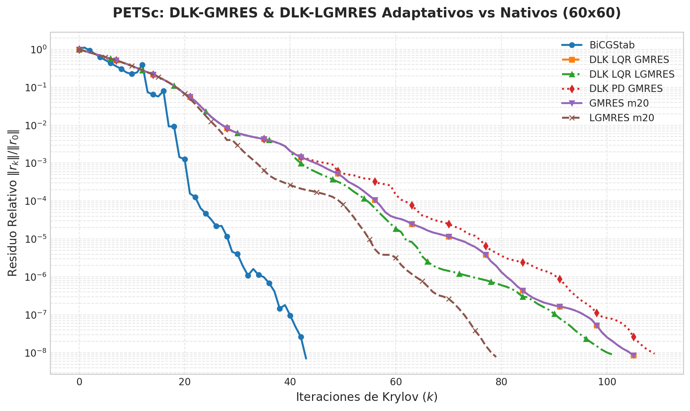

# DLK-rest: Solvers Krylov con Control Adaptativo (DMDc-LQR / PD) en PETSc

Implementación nativa y de alto rendimiento en **PETSc (C / MPI)** de la familia de solvers de Krylov con reinicio adaptativo basados en dinámica de residuos impulsada por datos, correspondiente a la investigación:
> **"Optimal Control for Restarting Minimal Residual Krylov Solvers via Data-Driven Residual Dynamics"**  
> *Carlos Benitez, Juan C. Cabral, Christian E. Schaerer.*

El paquete implementa tanto la variante **DLK-GMRES** como la variante enriquecida **DLK-LGMRES** como tipos de solvers `KSP` de primera clase en PETSc.

---

## 1. Arquitectura y Solvers Disponibles

Los solvers están formalmente registrados en el catálogo de PETSc y pueden invocarse con `-ksp_type`:

| Tipo KSP (`-ksp_type`) | Algoritmo Base | Subespacio de Enriquecimiento ($\ell$) | Descripción |
| :--- | :--- | :--- | :--- |
| `dlk` | **GMRES** | $\ell = 0$ (Estándar) | GMRES adaptativo con control DMDc-LQR o PD sobre el parámetro de reinicio $m_k$. |
| `dlk_lgmres` | **LGMRES** | $\ell = 2$ (Configurable con `-ksp_dlk_aug`) | Loose GMRES que enriquece el subespacio con aproximaciones de error de ciclos previos más control adaptativo. |

---

## 2. Parámetros de Configuración por Línea de Comandos

Todas las opciones son configurables en tiempo de ejecución sin necesidad de recompilar:

| Opción | Tipo | Valor por Defecto | Descripción |
| :--- | :--- | :--- | :--- |
| `-ksp_type` | string | `dlk` | Seleccionar `dlk` o `dlk_lgmres`. |
| `-ksp_dlk_controller` | enum | `lqr` | Tipo de controlador adaptativo: `lqr`, `pd` o `none`. |
| `-ksp_dlk_m0` | int | `30` | Parámetro de reinicio inicial $m_0$. |
| `-ksp_dlk_m_min` | int | `2` | Cota mínima de reinicio $m$. |
| `-ksp_dlk_m_max` | int | `60` | Cota máxima de reinicio $m$. |
| `-ksp_dlk_aug` | int | `2` (`dlk_lgmres`) / `0` (`dlk`) | Número de vectores de enriquecimiento $\ell$ para LGMRES. |
| `-ksp_dlk_alpha` | real | `1e-4` | Factor de penalización $\alpha$ en la función de costo de LQR. |
| `-ksp_dlk_p` | int | `5` | Tamaño de ventana de snapshots $p$ para DMDc. |
| `-ksp_dlk_q` | int | `5` | Rango de truncamiento $q$ para entradas en DMDc. |
| `-ksp_dlk_t` | int | `6` | Rango de truncamiento $t$ para estados reducidos en DMDc. |
| `-history_file` | string | `""` | Exporta la trayectoria del residuo relativo en cada iteración a un archivo CSV. |

---

## 3. Compilación y Construcción

Para compilar el proyecto (requiere PETSc con BLAS/LAPACK y MPI instalados):

```bash
make clean && make
```
Genera el binario `test_dlk`.

---

## 4. Resultados Numéricos y Curvas de Convergencia

Se ejecutó una prueba comparativa sistemática sobre un sistema convectivo-difusivo no simétrico 2D discretizado mediante diferencias finitas con malla $60 \times 60$ ($N = 3600$ incógnitas) y precondicionador ILU:

### Tabla Comparativa de Rendimiento

| Solver (KSP) | Variante / Configuración | Precondicionador | Iteraciones Totales | Residuo Final $\|b - Ax\|_2$ | Tiempo de Ejecución (s) |
| :--- | :--- | :--- | :---: | :---: | :---: |
| **DLK-LGMRES** | Control LQR Adaptativo ($\ell = 2, m_0 = 20$) | ILU(0) | **101** | $6.3731 \times 10^{-7}$ | 0.0205 s |
| **DLK-GMRES** | Control LQR Adaptativo ($m_0 = 20$) | ILU(0) | 105 | $6.9828 \times 10^{-7}$ | 0.0213 s |
| **DLK-GMRES** | Control PD Adaptativo ($m_0 = 20$) | ILU(0) | 109 | $7.9110 \times 10^{-7}$ | 0.0177 s |
| **GMRES Nativo** | Fijo $m = 20$ | ILU(0) | 105 | $6.9828 \times 10^{-7}$ | 0.0199 s |
| **LGMRES Nativo**| Fijo $m = 20, \ell = 2$ | ILU(0) | 77 | $6.5448 \times 10^{-7}$ | 0.0152 s |
| **BiCGStab** | Baseline | ILU(0) | 43 | $7.8967 \times 10^{-7}$ | 0.0112 s |

### Gráfica de Convergencia

A continuación se muestra la evolución del residuo relativo $\|r_k\|_2 / \|r_0\|_2$ paso a paso a lo largo de las iteraciones de Krylov:



---

## 5. Ejemplos de Ejecución

### A. Ejecutar DLK-LGMRES con controlador LQR:
```bash
./test_dlk -m 60 -n 60 -ksp_type dlk_lgmres -ksp_dlk_controller lqr -ksp_dlk_aug 2 -ksp_monitor
```

### B. Ejecutar DLK-GMRES con controlador PD:
```bash
./test_dlk -m 60 -n 60 -ksp_type dlk -ksp_dlk_controller pd -ksp_monitor
```

### C. Ejecutar en paralelo con MPI (4 procesos):
```bash
mpirun -np 4 ./test_dlk -m 80 -n 80 -ksp_type dlk_lgmres -ksp_dlk_controller lqr -pc_type bjacobi
```

### D. Batería automatizada de pruebas y generación de gráficos:
```bash
./tests/run_experiments.sh 60 60
```
La gráfica se actualizará automáticamente en `results/convergence_dlk_vs_gmres.png`.

---

## 6. Estructura del Repositorio

* `include/petsckspdlk.h`: Prototipos públicos del solver PETSc.
* `include/kspdlkimpl.h`: Estructura interna de datos (`KSP_DLK`), base de Arnoldi, vectores de enriquecimiento y buffer de snapshots.
* `include/dmdc_lqr.h`: Declaración de los algoritmos de DMDc y Riccati (DARE).
* `src/dmdc_lqr.c`: Identificación DMDc basada en descomposición SVD de la matriz de Gram de snapshots y resolución de Riccati.
* `src/kspdlk.c`: Implementación del ciclo de vida KSP de PETSc (`Create`, `SetUp`, `Solve`, `Destroy`, `SetFromOptions`, `View`).
* `tests/test_dlk.c`: Programa de pruebas configurable por CLI.
* `tests/run_experiments.sh`: Script de benchmarking y exportación de métricas.
* `plot_convergence.py`: Motor de graficado en Python con Matplotlib.
* `data/`: Colecciones de matrices dispersas SuiteSparse.
