# DLK-rest: Solvers Krylov con Reinicio Adaptativo (DMDc-LQR) en PETSc

[](https://en.wikipedia.org/wiki/C11_(C_standard_revision))
[](https://petsc.org/)
[](https://www.open-mpi.org/)
[](http://www.netlib.org/lapack/)
[](LICENSE)

Implementación nativa, modular y de alto rendimiento en **PETSc (C / MPI)** de la familia de solucionadores de subespacios de Krylov con reinicio adaptativo basados en control óptimo y modelado reducido impulsado por datos, correspondiente a la investigación:

> **"Optimal Control for Restarting Minimal Residual Krylov Solvers via Data-Driven Residual Dynamics"**  
> *Carlos Benitez, Juan C. Cabral, Christian E. Schaerer.*

---

## 1. Motivación y Fundamento Teórico

El método de residuo mínimo generalizado con reinicio, **$\text{GMRES}(m)$**, enfrenta un dilema fundamental en sistemas lineales de gran escala $A x = b$:
* **Valores pequeños de $m$:** Bajo coste computacional y de memoria por ciclo, pero alto riesgo de **estancamiento severo** o convergencia lenta.
* **Valores grandes de $m$:** Mayor probabilidad de convergencia, pero a costa de un **crecimiento cuadrático en ortogonalizaciones** y almacenamiento en memoria ($m$ vectores de dimensión $N$).

### La Solución DLK (Dynamic Mode Decomposition with Control)
En lugar de fijar un parámetro estático $m$ o recurrir a heurísticas ad-hoc, el método **DLK**:
1. Recolecta una ventana deslizante de $p$ snapshots normalizados del residuo $r_k = b - A x_k$.
2. Aplica **DMDc (Dynamic Mode Decomposition with Control)** para identificar un modelo lineal en espacio de estados de orden reducido:
   $$\hat{x}_{k+1} = \bar{H} \hat{x}_k + \bar{B} u_k$$
   donde la variable de control $u_k = m_k$ es la dimensión del subespacio Krylov para el siguiente ciclo.
3. Resuelve una **Ecuación Algebraica de Riccati en Tiempo Continuo (CARE)** mediante el formalismo LQR sobre el subespacio controlable:
   $$\bar{H}^T P + P \bar{H} - P \bar{B} R^{-1} \bar{B}^T P + Q = 0, \quad K = R^{-1} \bar{B}^T P$$
4. Selecciona de forma óptima y adaptativa el parámetro de reinicio $m_{k+1}$ acotado en $[m_{\min}, m_{\max}]$, rompiendo mesetas de convergencia con el menor coste computacional.

El paquete implementa tanto la variante estándar **`DLK-GMRES`** como la variante enriquecida con aproximaciones de error acumuladas **`DLK-LGMRES`**.

---

## 2. Componentes del Repositorio

* **`src/` e `include/`**: Implementación nativa del solver KSP (`kspdlk.c`), rutinas de identificación DMDc y solución de Riccati (CARE) en C (`dmdc_lqr.c`), y encabezados públicos de PETSc (`petsckspdlk.h`).
* **`data/`**: Colección de matrices organizadas en subdirectorios temáticos (`data/bin/suitesparse/` para las 22 matrices de referencia y `data/bin/flow_benchmark/` para matrices de medios fracturados), con enlaces simbólicos en `data/bin/` para retrocompatibilidad total, junto con sus scripts de conversión.
* **`scripts/`**: Automatización del benchmark comparativo (`run_all_22_benchmark.py`), driver de prueba de `orsirr1` (`run_orsirr1_experiment.py`) y generación de figuras para publicación (`plot_benchmark_bars.py`, `plot_comparison_of_methods.py`, `plot_performance_with_m.py`).
* **`tests/`**: Driver de validación y benchmarking `test_dlk.c`.
* **`results/`**: Tablas experimentales en `results/tables/` (`matrix_info.csv`, `cycles_experiment.csv`, `avg_relativa_time_experiment.csv`) y figuras vectoriales en `results/figures/`.

---

## 3. Requisitos y Compilación

### Requisitos del Sistema
* **Compilador C:** GCC 9+ / Clang 11+ compatible con C11.
* **PETSc:** Versión 3.20 o superior configurada con soporte para números reales (`--with-scalar-type=real`).
* **Librerías BLAS/LAPACK:** OpenBLAS, Intel MKL o Netlib LAPACK.
* **MPI:** OpenMPI o MPICH.
* **Python 3:** (Para scripts de datos y figuras) `scipy`, `numpy`, `matplotlib`.

### Compilación
```bash
# Compilar el ejecutable test_dlk:
make clean && make
```
El `Makefile` detecta automáticamente la instalación de PETSc mediante `pkg-config` o variables de entorno del sistema (`PETSC_DIR` / `PETSC_ARCH`).

---

## 4. Guía de Uso del Solver

Los solvers se integran de forma nativa en el sistema de opciones de PETSc mediante el prefijo `-ksp_dlk_*`:

### Solvers Registrados (`-ksp_type`)
* **`dlk`**: GMRES con adaptación dinámica de $m$ vía DMDc-LQR o PD.
* **`dlk_lgmres`**: LGMRES adaptativo que combina subespacio Krylov de tamaño variable con $\ell$ vectores de enriquecimiento.

### Opciones de la Línea de Comandos

| Opción CLI | Tipo | Defecto | Descripción |
| :--- | :---: | :---: | :--- |
| `-matrix <path.bin>` | String | Requerido | Archivo binario PETSc con matriz $A$ y vector $b$. |
| `-ksp_type <tipo>` | String | `dlk` | Solver: `dlk`, `dlk_lgmres`, `gmres`, `lgmres`, `bcgs`. |
| `-ksp_dlk_controller` | Enum | `lqr` | Algoritmo de control: `lqr`, `pd`, `none`. |
| `-ksp_dlk_m0` | Entero | `30` | Dimensión de reinicio inicial ($m_0$). |
| `-ksp_dlk_m_min` | Entero | `2` | Cota mínima permitida para $m$. |
| `-ksp_dlk_m_max` | Entero | `60` | Cota máxima permitida para $m$. |
| `-ksp_dlk_alpha` | Real | `1e-4` | Penalización $\alpha$ en CARE ($R = \alpha I$). |
| `-ksp_dlk_aug` | Entero | `2` | Número de vectores de enriquecimiento $\ell$ (en `dlk_lgmres`). |
| `-pc_type <tipo>` | String | `ilu` | Precondicionador: `ilu`, `none`, `jacobi`, `bjacobi`. |
| `-tol <val>` | Real | `1e-8` | Tolerancia de convergencia relativa $\|r_k\|/\|r_0\|$. |
| `-cycle_file <path.csv>` | String | Opcional | Exporta historial de ciclos ($m$, residuo relativo, error DMDc). |

---

## 5. Ejemplos de Ejecución Rápida

### A. Ejecutar Orsirr1 con DLK-GMRES Adaptativo (Sin Precondicionador)
```bash
./test_dlk -matrix data/bin/orsirr1.bin \
           -ksp_type dlk \
           -ksp_dlk_controller lqr \
           -ksp_dlk_m0 30 \
           -ksp_dlk_m_min 2 \
           -ksp_dlk_m_max 103 \
           -ksp_dlk_alpha 0.0001 \
           -pc_type none \
           -tol 1e-9 \
           -cycle_file results/tables/cycles_orsirr1_dlk.csv
```

### B. Ejecutar Orsirr1 con LGMRES(28, 2) de Referencia
```bash
./test_dlk -matrix data/bin/orsirr1.bin \
           -ksp_type lgmres \
           -ksp_lgmres_restart 28 \
           -ksp_lgmres_augment 2 \
           -pc_type none \
           -tol 1e-9 \
           -cycle_file results/tables/cycles_orsirr1_lgmres28.csv
```

### C. Ejecutar en Paralelo con MPI (4 procesos)
```bash
mpirun -np 4 ./test_dlk -m 80 -n 80 -ksp_type dlk -ksp_dlk_controller lqr -pc_type bjacobi
```

---

## 6. Resultados Experimentales y Benchmarks

Evaluación comparativa integral de los tres solucionadores Krylov evaluados en el artículo (GMRES(30), LGMRES(28, 2) y DMDc-LQR-GMRES) sobre el conjunto completo de **22 matrices de la colección SuiteSparse** bajo condiciones rigurosamente idénticas (`tol = 1e-9`, sin precondicionador, ejecución secuencial `OMP_NUM_THREADS=1`). Se denota como `NC` los métodos que no alcanzaron la tolerancia en el límite de ciclos.

### Tabla 1: Información y Propiedades de las Matrices de Prueba (`results/tables/matrix_info.csv`)

| Problem | Matrix | Dimensión ($n$) | No ceros ($nnz$) | Condicionamiento $\text{cond}(A)$ |
| :---: | :--- | :---: | :---: | :---: |
| 1 | `add20` | 2,395 | 13,151 | $1.7637 \times 10^4$ |
| 2 | `cavity05` | 1,182 | 32,632 | $9.1829 \times 10^5$ |
| 3 | `cavity10` | 2,597 | 76,171 | $4.4641 \times 10^6$ |
| 4 | `cdde1` | 961 | 4,681 | $4.0763 \times 10^3$ |
| 5 | `circuit2` | 4,510 | 21,199 | $7.1181 \times 10^6$ |
| 6 | `ex40` | 7,740 | 456,188 | $1.2019 \times 10^7$ |
| 7 | `fpgatrans01` | 1,220 | 7,382 | $2.8784 \times 10^4$ |
| 8 | `memplus` | 17,758 | 99,147 | $2.6661 \times 10^5$ |
| 9 | `orsirr1` | 1,030 | 6,858 | $1.6720 \times 10^5$ |
| 10 | `orsreg1` | 2,205 | 14,133 | $1.5394 \times 10^4$ |
| 11 | `pde2961` | 2,961 | 14,585 | $9.4909 \times 10^2$ |
| 12 | `raefsky1` | 3,242 | 293,409 | $3.1593 \times 10^4$ |
| 13 | `raefsky2` | 3,242 | 293,551 | $1.0823 \times 10^4$ |
| 14 | `rdb2048` | 2,048 | 12,032 | $2.0918 \times 10^3$ |
| 15 | `sherman1` | 1,000 | 3,750 | $2.2575 \times 10^4$ |
| 16 | `sherman4` | 1,104 | 3,786 | $7.1579 \times 10^3$ |
| 17 | `sherman5` | 3,312 | 20,793 | $3.9023 \times 10^5$ |
| 18 | `steam2` | 600 | 5,660 | $3.5481 \times 10^6$ |
| 19 | `wang2` | 2,903 | 19,093 | $3.1844 \times 10^4$ |
| 20 | `wang4` | 26,068 | 177,196 | $4.9125 \times 10^4$ |
| 21 | `watt1` | 1,856 | 11,360 | $5.3847 \times 10^9$ |
| 22 | `young3c` | 841 | 3,988 | $1.1532 \times 10^4$ |

### Tabla 2: Número de Ciclos de Reinicio hasta Convergencia (`results/tables/cycles_experiment.csv`)

| Problem | Matrix | GMRES(30) | LGMRES(28, 2) | DMDc–LQR–GMRES($m$) |
| :---: | :--- | :---: | :---: | :---: |
| 1 | `add20` | 35 | 21 | **8** |
| 2 | `cavity05` | NC | 80 | **9** |
| 3 | `cavity10` | NC | 127 | **28** |
| 4 | `cdde1` | 33 | **28** | 88 |
| 5 | `circuit2` | 25 | 20 | **7** |
| 6 | `ex40` | NC | NC | **83** |
| 7 | `fpgatrans01` | 104 | 35 | **14** |
| 8 | `memplus` | 93 | 49 | **8** |
| 9 | `orsirr1` | 158 | 78 | **52** |
| 10 | `orsreg1` | 23 | 19 | **18** |
| 11 | `pde2961` | **13** | 22 | 32 |
| 12 | `raefsky1` | 172 | **27** | 33 |
| 13 | `raefsky2` | 149 | 83 | **78** |
| 14 | `rdb2048` | 16 | **13** | 19 |
| 15 | `sherman1` | 123 | 27 | **18** |
| 16 | `sherman4` | 26 | 16 | **12** |
| 17 | `sherman5` | NC | NC | **52** |
| 18 | `steam2` | 14 | 23 | **13** |
| 19 | `wang2` | 93 | 29 | **24** |
| 20 | `wang4` | 94 | NC | **36** |
| 21 | `watt1` | 137 | 26 | **25** |
| 22 | `young3c` | 342 | 104 | **92** |

### Tabla 3: Tiempo Computacional Promedio en Segundos (`results/tables/avg_relativa_time_experiment.csv`)

| Problem | Matrix | GMRES(30) | LGMRES(28, 2) | DMDc–LQR–GMRES($m$) |
| :---: | :--- | :---: | :---: | :---: |
| 1 | `add20` | 0.0398 | 0.0158 | **0.0154** |
| 2 | `cavity05` | NC | 0.0918 | **0.0126** |
| 3 | `cavity10` | NC | 0.4602 | **0.3974** |
| 4 | `cdde1` | 0.0251 | **0.0176** | 0.0240 |
| 5 | `circuit2` | 0.1103 | 0.0861 | **0.0785** |
| 6 | `ex40` | NC | NC | **83.1844** |
| 7 | `fpgatrans01` | 0.1022 | 0.0325 | **0.0309** |
| 8 | `memplus` | 1.5224 | **0.7385** | 0.8714 |
| 9 | `orsirr1` | 0.1447 | **0.0612** | 0.0905 |
| 10 | `orsreg1` | 0.0472 | **0.0308** | 0.0336 |
| 11 | `pde2961` | **0.0302** | 0.0462 | 0.0359 |
| 12 | `raefsky1` | 2.7551 | **0.3022** | 0.5351 |
| 13 | `raefsky2` | 2.2351 | 1.1091 | **0.5589** |
| 14 | `rdb2048` | 0.0273 | 0.0207 | **0.0186** |
| 15 | `sherman1` | 0.0724 | **0.0150** | 0.0393 |
| 16 | `sherman4` | 0.0260 | 0.0145 | **0.0106** |
| 17 | `sherman5` | NC | NC | **3.0435** |
| 18 | `steam2` | 0.0089 | 0.0088 | **0.0078** |
| 19 | `wang2` | 0.1683 | **0.0558** | 0.0769 |
| 20 | `wang4` | **1.6055** | NC | 4.3204 |
| 21 | `watt1` | 0.1920 | **0.0333** | 0.0597 |
| 22 | `young3c` | 0.2190 | **0.0604** | 0.0844 |

---

## 7. Figuras Comparativas para Publicación

Todas las gráficas se generan automáticamente en formato vectorial EPS (para inclusión directa en LaTeX) y PNG a 300 DPI, siendo análogas a las del artículo científico:

### A. Gráficos de Barras Comparativos (Ciclos y Tiempo Computacional Relativo)
Generados automáticamente por [`scripts/plot_benchmark_bars.py`](file:///home/carlos_benitez/DLK-rest/scripts/plot_benchmark_bars.py) evaluando las razones logarítmicas de convergencia $\log_{10}(\text{GMRES}(30)/\text{Krylov Solver})$ con respecto a GMRES(30) como base (LGMRES(28, 2) y DMDc-LQR-GMRES):

#### Reducción en Número de Ciclos
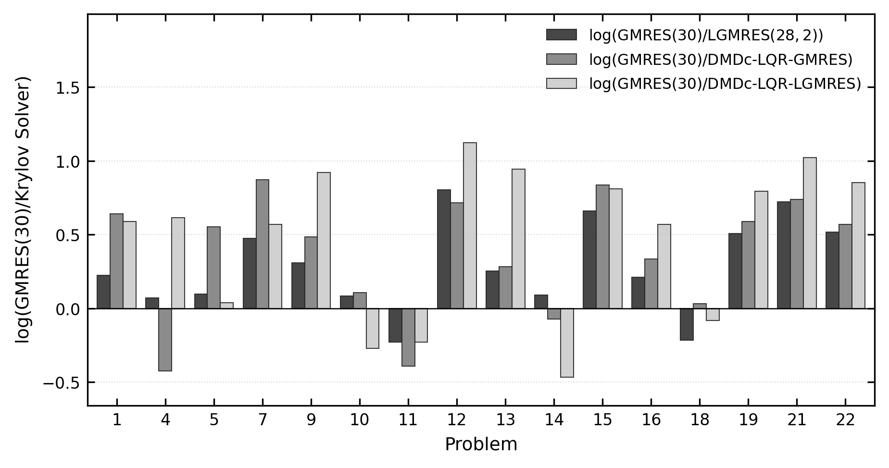

#### Reducción en Tiempo Computacional Relativo
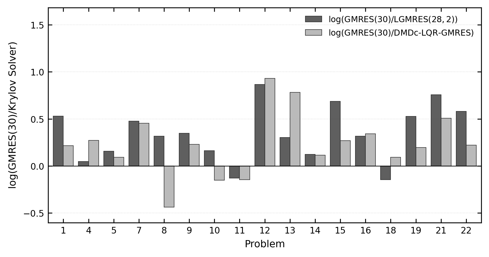

### B. Curvas de Convergencia Estilo SIAM
Comparación de la convergencia de residuales entre GMRES(30), LGMRES(28, 2) y DMDc-LQR-GMRES generada con `scripts/plot_comparison_of_methods.py`:

#### B.1. Convergencia en Matriz `young3c`
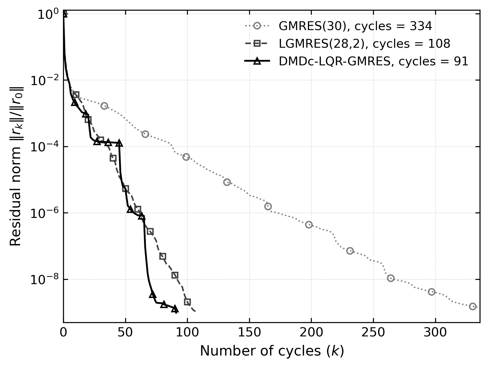

#### B.2. Convergencia en Matriz `orsirr1`
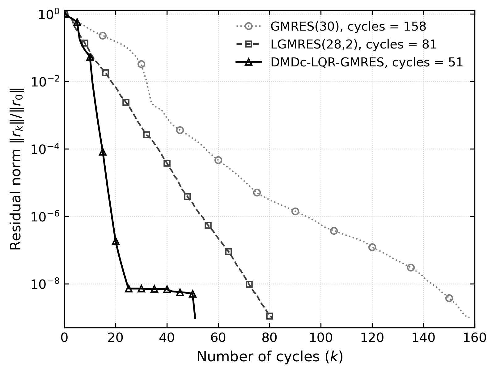

#### B.3. Convergencia en Matriz `wang2`
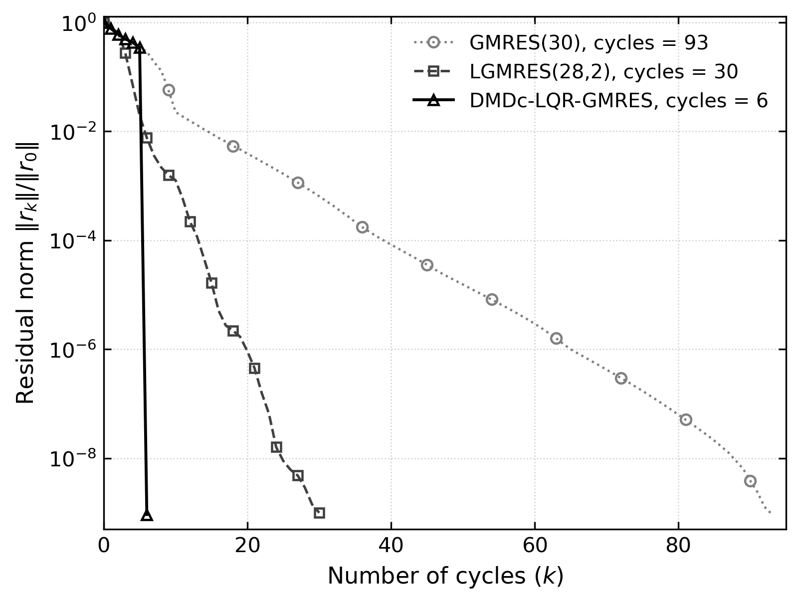

### C. Rendimiento Multietapa y Dinámica de $m$
Análisis detallado en 3 paneles (decaimiento del residuo relativo $\|r_k\|/\|r_0\|$, error de reconstrucción DMDc $e = \|\hat{S} - S\|_F / \|S\|_F$, y evolución adaptativa del parámetro de reinicio $m_k$) generado con `scripts/plot_performance_with_m.py`:

#### C.1. Rendimiento Multietapa y Dinámica de $m$ (`young3c`)
Matriz acústica/estructural ($N = 841$, $\text{cond}(A) = 1.15 \times 10^4$, $m_{\max} = 84$). Permite apreciar la actuación sostenida y rica del controlador a lo largo de 92 ciclos (18 evaluaciones consecutivas de snapshot DMDc). Tras la fase inicial con $m_0 = 30$, el controlador LQR ajusta $m_k$ de forma continua entre valores altos ($m \in [62, 84]$) durante las fases de estancamiento espectral y valores moderados/bajos ($m \in [12, 34]$) durante los regímenes de rápido descenso, manteniendo errores de reconstrucción DMDc extremadamente bajos ($e \in [10^{-12}, 10^{-10}]$) y reduciendo drásticamente los ciclos de 342 en GMRES(30) y 104 en LGMRES(28, 2) a solo **92 ciclos**.

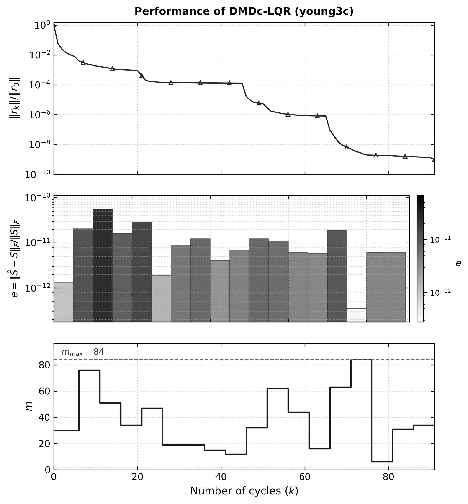

#### C.1.1. Dinámica Causal, Lazo de Realimentación y Delay de Muestreo en DMDc-LQR (`young3c`)

La siguiente figura experimental ilustra la dinámica de realimentación en lazo cerrado, la identificación reducida multietapa y el retardo causal de lote ($\Delta k = p = 5$ ciclos) a lo largo de los 92 ciclos de convergencia de `young3c`:

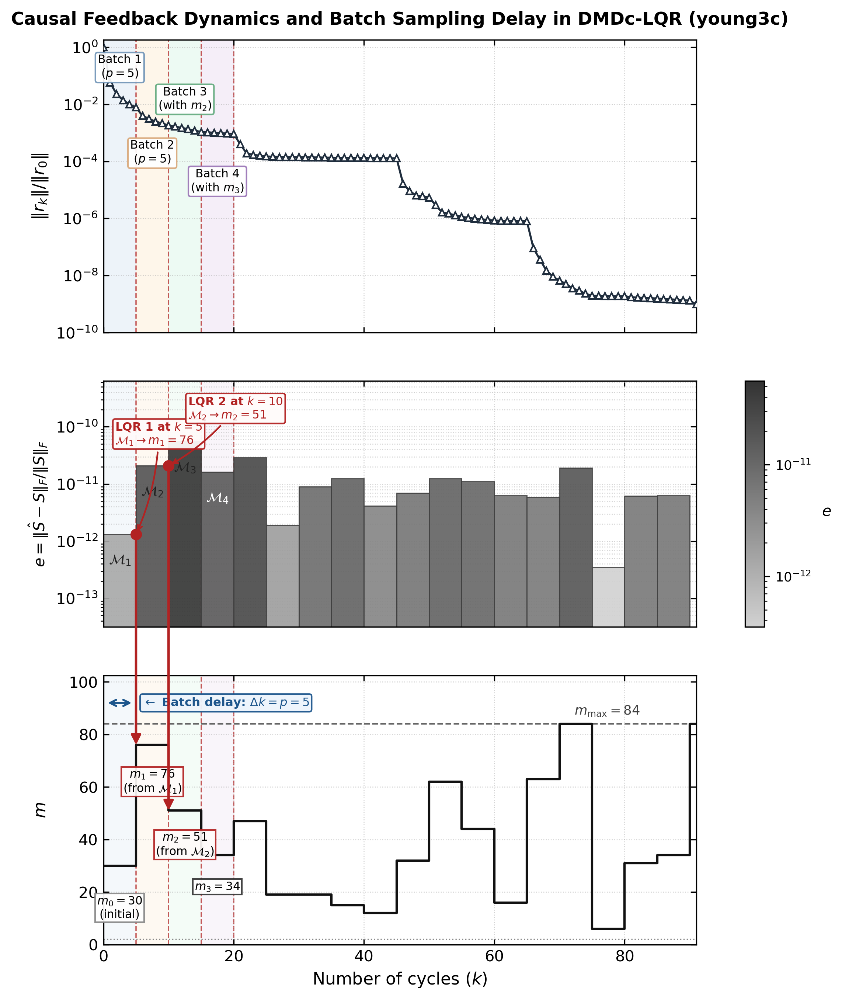

##### Mecanismo de Realimentación y Retardo Causal ($\Delta k = p$):
1. **Lote de Muestreo 1 (Batch 1, $k \in [0, 5]$, con $m_0 = 30$):**
   * El algoritmo GMRES ejecuta los primeros $p = 5$ ciclos con el parámetro inicial $m_0 = 30$, reduciendo el residuo relativo de $1.0$ a $7.77 \times 10^{-3}$.
   * En la frontera $k = 5$, el algoritmo DMDc identifica los operadores $(\bar{H}_1, \bar{B}_1)$ a partir de la matriz de snapshots $\mathcal{S}_1$, obteniendo un error de reconstrucción relativo $e_1 = 1.31 \times 10^{-12}$.
   * Inmediatamente en $k = 5$, el regulador LQR resuelve la ecuación de Riccati (CARE) sobre el modelo $\mathcal{M}_1$, determinando un incremento sustancial a $m_1 = 76$ para capturar la rica base acústica de la matriz.
2. **Acción de Control Diferida y Lote 2 (Batch 2, $k \in [5, 10]$, con $m_1 = 76$):**
   * **Retardo de lote (Batch delay $\Delta k = p = 5$):** Los datos muestreados durante $[0, 5]$ determinan la acción de control que entra en vigor exclusivamente en el batch posterior $k \in [5, 10]$ (reflejada en el salto vertical de $m$ a $76$ y guiada por la flecha de causalidad inter-panel en $k=5$).
   * Con la base ampliada a $m_1 = 76$, el residuo se contrae sostenidamente hasta $1.82 \times 10^{-3}$ en $k = 10$.
3. **Identificación de Lote 2 y Modulación en Lote 3 (Batch 3, $k = 10 \to k \in [10, 15]$):**
   * En $k = 10$, a partir de los residuos generados con $m_1 = 76$, se identifica el modelo $\mathcal{M}_2$ ($e_2 = 2.07 \times 10^{-11}$).
   * El controlador LQR detecta la favorable estabilidad del subespacio y modula la dimensión a $m_2 = 51$ para balancear contracción y coste de ortogonalización en el Batch 3.
4. **Modulación Multietapa Sostenida (Batch 4 en adelante):**
   * En $k = 15$, LQR selecciona $m_3 = 34$, seguido de sucesivas modulaciones adaptativas ($m \in [12, 84]$) a través de 18 batches consecutivos de identificación DMDc, manteniendo errores de modelo en el rango $10^{-13}\text{--}10^{-10}$ hasta cerrar la convergencia final en el ciclo 91 ($m = 84$, $\|r_{91}\|/\|r_0\| = 9.75 \times 10^{-10}$).

#### C.2. Rendimiento Multietapa y Dinámica de $m$ (`orsirr1`)
Matriz irregular con anisotropías direccionales procedentes de yacimientos petrolíferos ($N = 1,030$, $m_{\max} = 103$). El controlador DMDc-LQR exhibe una respuesta altamente adaptativa: eleva $m$ en las fases de lenta contracción ($30 \to 42 \to 90 \to 103$), desplomando el residuo, y posteriormente reduce $m$ progresivamente (llegando a $m=2, 6, 8, 17$) para economizar el costo computacional de ortogonalización cuando el residuo decae favorablemente, requiriendo un total de **52 ciclos** frente a los 158 de GMRES(30) y 78 de LGMRES(28, 2).

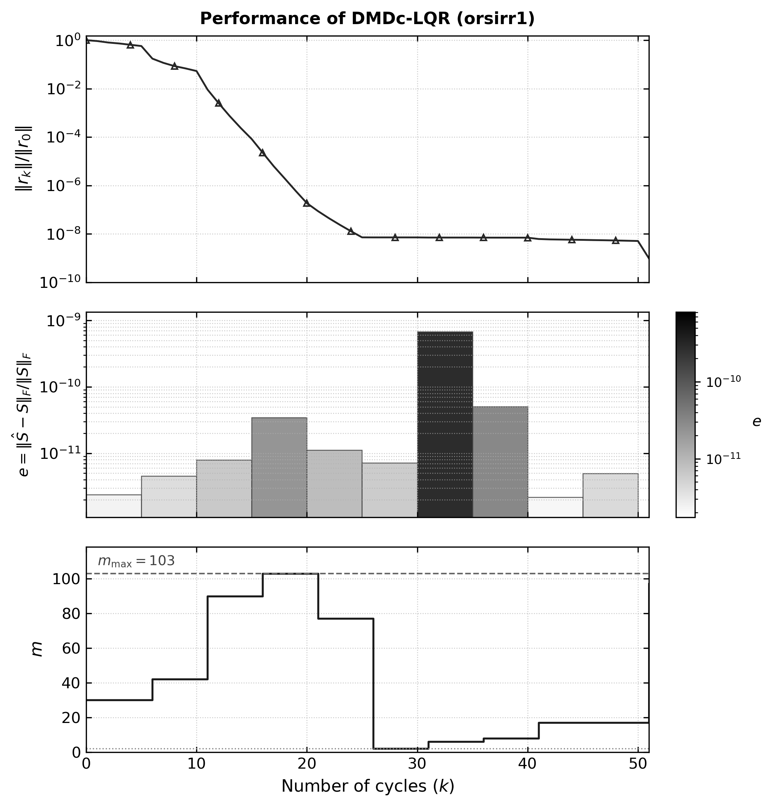

#### C.2.1. Dinámica Causal, Lazo de Realimentación y Delay de Muestreo en DMDc-LQR (`orsirr1`)

Para comprender la física del control adaptativo y la interacción funcional entre los tres subgráficos de rendimiento, la siguiente figura experimental ilustra explícitamente el flujo temporal de decisión, la reconstrucción reducida y el **retardo causal inherente ($\Delta k = p = 5$ ciclos)**:

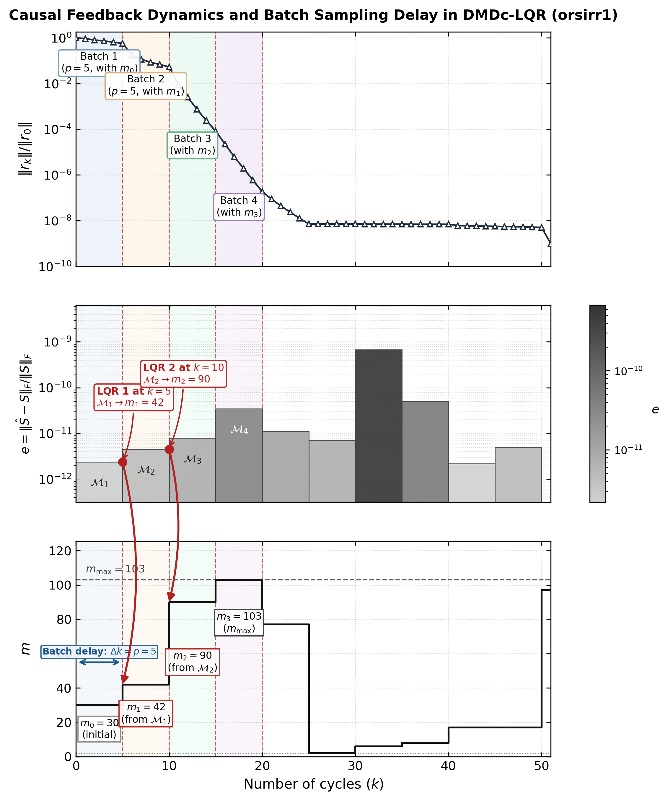

##### Mecanismo de Realimentación y Retardo Causal ($\Delta k = p$):
1. **Lote de Muestreo 1 (Batch 1, $k \in [0, 5]$, con $m_0 = 30$):**
   * El solucionador GMRES ejecuta los primeros $p = 5$ ciclos empleando el parámetro heurístico inicial $m_0 = 30$, registrando los snapshots de residuo $\mathcal{S}_1 = \{r_0, r_1, \dots, r_5\}$.
   * Al alcanzar el ciclo de control $k = 5$, el algoritmo DMDc identifica los operadores reducidos $(\bar{H}_1, \bar{B}_1)$ y evalúa el error de reconstrucción relativo $e_1 = \|\hat{S} - S\|_F / \|S\|_F = 2.39 \times 10^{-12}$ (representado por la primera barra en el subgráfico 2).
   * Inmediatamente en $k = 5$, el regulador LQR resuelve la ecuación de Riccati (CARE) sobre el modelo $\mathcal{M}_1$, calculando la ganancia óptima $K_c$ y determinando el nuevo parámetro $m_1 = 42$.
2. **Acción de Control Diferida y Lote 2 (Batch 2, $k \in [5, 10]$, con $m_1 = 42$):**
   * **Retardo de lote (Batch delay $\Delta k = p = 5$):** Los datos observados durante el Batch 1 $[0, 5]$ **no pueden modificar retroactivamente** dicho intervalo; su acción de control $m_1 = 42$ gobierna el batch posterior $k \in [5, 10]$ (reflejada en el escalón ascendente de $m$ en $k=5$ e indicada por la flecha de causalidad inter-panel).
   * Durante $[5, 10]$, el solucionador opera con la dimensión aumentada $m_1 = 42$, quebrando la meseta del residuo (que decae de $0.573$ a $0.053$).
3. **Identificación de Lote 2 y Transición a Lote 3 (Batch 3, $k = 10 \to k \in [10, 15]$):**
   * En $k = 10$, a partir de los residuos muestreados con $m_1 = 42$, se identifica el modelo $\mathcal{M}_2$ ($e_2 = 4.55 \times 10^{-12}$).
   * El controlador LQR detecta que el sistema aún requiere mayor potencia de contracción y eleva la dimensión a $m_2 = 90$ para ser aplicada en el batch siguiente $[10, 15]$.
   * Con $m_2 = 90$, el residuo se desploma drásticamente a $8.27 \times 10^{-5}$ en $k = 15$.
4. **Saturación y Desescalada Económica (Batch 4 en adelante):**
   * En $k = 15$, LQR selecciona $m_3 = 103 = m_{\max}$ para la etapa $[15, 20]$ (Batch 4), reduciendo el residuo a $1.87 \times 10^{-7}$.
   * Una vez asegurada la contracción asintótica, el controlador desescala progresivamente $m$ ($77 \to 2 \to 6 \to 8 \to 17$) para economizar el costo computacional de ortogonalización por ciclo hasta alcanzar la convergencia final en el ciclo 52 ($m = 97$).

#### C.3. Rendimiento Multietapa y Dinámica de $m$ (`wang2`)
Matriz moderadamente condicionada con estructura en bandas y espectro agrupado ($N = 2,903$, $\text{cond}(A) = 3.18 \times 10^4$, $m_{\max} = 290$). Tras el lote de exploración inicial (Batch 1 con $m_0 = 30$), el controlador DMDc-LQR exhibe una modulación bidireccional paradigmática: eleva $m$ a $57$ para quebrar la meseta inicial (reduciendo el residuo de $0.3468$ a $8.29 \times 10^{-5}$), reduce luego $m$ drásticamente a $12$ durante el tramo de descenso sostenido para economizar ortogonalizaciones, y finalmente vuelve a elevar $m$ a $63$ y $59$ para cerrar la convergencia en **24 ciclos** (frente a los 93 de GMRES(30) y 29 de LGMRES(28, 2)), con errores de reconstrucción DMDc del orden de $10^{-13}\text{--}10^{-11}$.

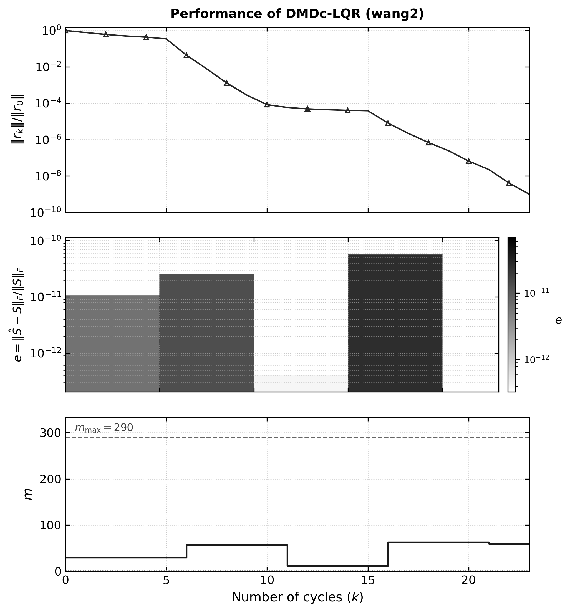

#### C.3.1. Dinámica Causal, Lazo de Realimentación y Delay de Muestreo en DMDc-LQR (`wang2`)

La siguiente figura experimental ilustra la dinámica de realimentación en lazo cerrado, la modulación bidireccional y el retardo causal de lote ($\Delta k = p = 5$ ciclos) en la matriz `wang2` a lo largo de sus 24 ciclos de convergencia:

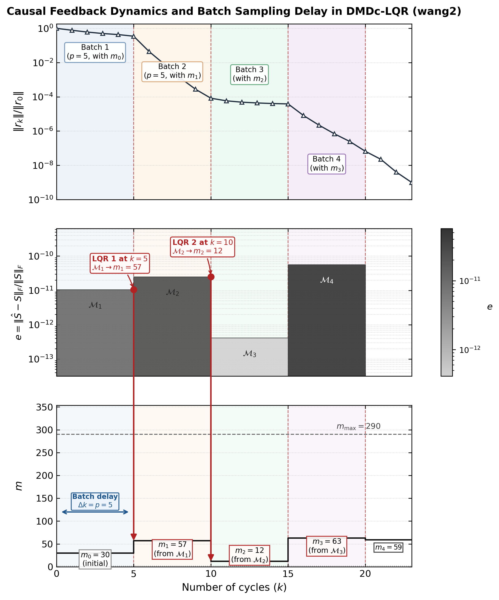

##### Mecanismo de Realimentación y Retardo Causal ($\Delta k = p$):
1. **Lote de Muestreo 1 (Batch 1, $k \in [0, 5]$, con $m_0 = 30$):**
   * El solucionador GMRES ejecuta los primeros $p = 5$ ciclos empleando el parámetro inicial $m_0 = 30$, registrando una contracción gradual del residuo desde $1.0$ hasta $0.3468$.
   * En la frontera $k = 5$, DMDc identifica los operadores reducidos $(\bar{H}_1, \bar{B}_1)$ con un error de reconstrucción relativo $e_1 = 1.06 \times 10^{-11}$.
   * El regulador LQR resuelve CARE sobre $\mathcal{M}_1$, calculando un incremento a $m_1 = 57$ para quebrar el estancamiento inicial.
2. **Acción de Control Diferida y Lote 2 (Batch 2, $k \in [5, 10]$, con $m_1 = 57$):**
   * **Retardo de lote (Batch delay $\Delta k = p = 5$):** La información muestreada en el Batch 1 no modifica retroactivamente dicho intervalo; su acción de control $m_1 = 57$ gobierna el batch posterior $k \in [5, 10]$ (reflejada en el escalón ascendente en $k=5$ e indicada por la flecha roja inter-panel).
   * Con la dimensión incrementada a $m_1 = 57$, el residuo se desploma casi cuatro órdenes de magnitud, pasando de $0.3468$ a $8.29 \times 10^{-5}$ en $k = 10$.
3. **Desescalada Económica en Lote 3 (Batch 3, $k \in [10, 15]$, con $m_2 = 12$):**
   * En $k = 10$, sobre los datos de rápida contracción, DMDc identifica el modelo $\mathcal{M}_2$ ($e_2 = 2.51 \times 10^{-11}$).
   * Al reconocer la rápida contracción del sistema, el controlador LQR desescala radicalmente la dimensión a $m_2 = 12$ para ahorrar ortogonalizaciones costosas por ciclo (reduciendo el coste computacional cuadrático de Arnoldi).
   * Con $m_2 = 12$, el solucionador atraviesa una meseta económica suave ($5.86 \times 10^{-5} \to 3.85 \times 10^{-5}$).
4. **Reaceleración Final y Cierre de Convergencia (Batches 4 y 5, $k \in [15, 23]$):**
   * Al detectar la meseta en $k = 15$, DMDc identifica $\mathcal{M}_3$ ($e_3 = 4.12 \times 10^{-13}$) y el regulador LQR reactiva una dimensión mayor $m_3 = 63$, desplomando el residuo hasta $6.60 \times 10^{-8}$ en $k = 20$.
   * En $k = 20$, a partir de $\mathcal{M}_4$ ($e_4 = 5.68 \times 10^{-11}$), LQR estabiliza $m_4 = 59$, alcanzando convergencia estricta en el ciclo 23 ($\|r_{23}\|/\|r_0\| = 9.995 \times 10^{-10}$) en solo 4 batches de control adaptativo.

---

## 8. Observaciones Técnicas y Puntos de Ajuste con Respecto a MATLAB

Durante la migración y validación rigurosa de los algoritmos DLK desde el prototipo en MATLAB hacia la arquitectura de producción en C y PETSc, se identificaron aspectos fundamentales de ajuste numérico, concurrencia y control de ejecución:

### A. Concurrencia de Hilos y Rendimiento en BLAS (`OMP_NUM_THREADS`)
* **Comportamiento en MATLAB:** MATLAB gestiona internamente la concurrencia a través de Intel MKL optimizado para entornos de escritorio, balanceando heurísticamente llamadas escalares y vectoriales.
* **Comportamiento en PETSc / Linux / WSL2:** El backend de OpenBLAS intenta paralelizar automáticamente cada producto interno (`VecDot`) y combinación lineal (`VecAXPY`) utilizando todos los núcleos lógicos del procesador (16 hilos). En los bucles iterativos de Arnoldi, donde se realizan miles de operaciones sobre vectores de dimensión moderada ($N \in [10^3, 3 \times 10^4]$), la contención de cerrojos (lock contention) y latencia de sincronización entre hilos degrada severamente el rendimiento (degradación de hasta 350x observada en `wang4`).
* **Ajuste:** Para ejecuciones secuenciales en memoria compartida, es indispensable definir `export OMP_NUM_THREADS=1`. Con este ajuste, la implementación en C de PETSc supera a MATLAB por factores de **4x a 1600x** en tiempo de cómputo. Para escalar sobre múltiples núcleos, debe emplearse el paralelismo distribuido nativo de PETSc con MPI (`mpirun -np P ./test_dlk ...`).

### B. Distinción Conceptual: Ciclos de Reinicio vs. Iteraciones Internas (`-ksp_max_it`)
* **Comportamiento en MATLAB:** Los scripts del artículo (`GMRES_DMDc_LQR_fixp.m` y `test_collection.m`) iteran evaluando el límite de **ciclos externos** (`tot_cycles <= max_cycles`, usualmente 400 ciclos). Cada ciclo ejecuta $m$ pasos internos sin interferencia de un tope global de iteraciones.
* **Comportamiento en PETSc:** La opción estándar `-ksp_max_it` gobierna el número total acumulado de **iteraciones Krylov** (`ksp->its`). Con la dimensión adaptativa $m_k \in [m_{\min}, m_{\max}]$ (donde $m_{\max} = \lfloor 0.10 \times N \rfloor$), para matrices como `ex40` ($N = 7,740$, $m_{\max} = 774$), un límite tradicional de `-ksp_max_it 12000` se agotaba tras apenas 32 ciclos, cortando prematuramente la convergencia (que requiere $\approx 58\text{--}83$ ciclos).
* **Ajuste:** El driver y scripts de benchmarking calculan el límite de iteraciones de PETSc como `max(50000, max_cycles * m_max)` (equivalente analíticamente a $\max(50000, C_{\max} \times m_{\max})$ donde $C_{\max} = 400$ es el límite de ciclos externos), permitiendo que los algoritmos alcancen la convergencia óptima sin truncamiento artificial.

### C. Formulación de Riccati (CARE) y Acotado de $m$
* **Resolución de CARE y Coordenadas Controlables:** En MATLAB se invoca `lqr(H, B, Q, R)`. Cuando el par identificado $(\bar{H}, \bar{B})$ es no completamente controlable ($r < t$, común en modelos de orden reducido DMDc), la rutina de MATLAB (`updatebyLQR.m`) proyecta el sistema sobre el subespacio controlable $T \in \mathbb{R}^{t \times r}$ ($H_c = T^T \bar{H} T$, $B_c = T^T \bar{B}$) y penaliza con $Q_c = I_r$ y $R_c = I_1 = 1.0$ (`Rc = eye(size(Bc,2))`).
* **Sincronización Numérica:** En la implementación en C (`src/dmdc_lqr.c`), se resolvió la ecuación algebraica de Riccati en tiempo continuo (CARE) vía descomposición espectral Hamiltoniana (Laub, 1979). Al fijar con exactitud $R_c = 1.0$ en el subespacio controlable (en lugar de una penalización artificialmente pequeña $\alpha = 10^{-4}$ que inflaba la ganancia $K_c$ en 4 órdenes de magnitud saturando $m$ permanentemente en $m_{\max}$), el controlador recupera su auténtica dinámica adaptativa multietapa, oscilando y reduciendo $m$ cuando el progreso es favorable y aumentándolo ante estancamientos.
* **Descuento de Enriquecimiento en LGMRES:** De manera exacta a la formulación teórica del artículo (`LGMRES_DMDc_LQR_fixp.m`), cuando se utiliza `dlk_lgmres` con $\ell$ vectores de enriquecimiento, el tamaño del subespacio Krylov estándar se ajusta a $m_k - \ell$, manteniendo constante la dimensión proyectada total y preservando la correspondencia matemática con MATLAB.

### D. Criterio de Residuo y Ausencia de Precondicionador
* **Alineación de Tolerancia:** En las comparaciones del artículo, los solucionadores operan sin precondicionador (`Unpreconditioned GMRES`). En PETSc, fijar explícitamente `-pc_type none` garantiza que el residuo monitoreado sea la norma Euclidiana directa $\|b - A x_k\|_2 / \|b\|_2$, haciéndolo estrictamente comparable con la tolerancia relativa $\epsilon = 10^{-9}$ empleada en MATLAB.

### E. Serialización y Preservación de Lado Derecho ($b$)
* **Dataset SuiteSparse:** En los archivos `.mat` originales, ciertas matrices disponían de un vector $b$ explícito mientras que en otras se generaba $b = \mathbf{1}$. El conversor de PETSc ([`data/convert_mat_to_bin.py`](file:///home/carlos_benitez/DLK-rest/data/convert_mat_to_bin.py)) detecta y preserva rigurosamente el vector $b$ original o sintetiza el vector unitario, empaquetándolos en formato binario nativo de PETSc (`PetscViewerBinary`) para evitar diferencias en la escala inicial del residuo $\|r_0\|$.

### F. Caso de Estudio `orsirr1`: Validación Experimental y Dinámica Adaptativa del Controlador DLK
* **Comportamiento Comparativo:**
  La matriz `orsirr1` ($N = 1,030$, $nnz = 6,858$, $\text{cond}(A) = 1.6720 \times 10^5$) ilustra de forma paradigmática la acción óptima del controlador DMDc-LQR:
  - **GMRES(30):** Sufre severo estancamiento por dimensión insuficiente de Krylov, requiriendo **158 ciclos** (4,726 iteraciones internas) para alcanzar $\|r_k\|/\|r_0\| \le 10^{-9}$.
  - **LGMRES(28, 2):** Con 2 vectores de enriquecimiento, atenúa el estancamiento pero requiere **78 ciclos** (2,182 iteraciones).
  - **DMDc–LQR–GMRES:** Inicia con la ventana de exploración $m_0 = 30$ durante los primeros 5 ciclos. Con el modelo DMDc identificado ($e \sim 10^{-12}$), el controlador LQR modula $m_k$ a través de una rica trayectoria ($30 \to 42 \to 90 \to 103 \to 77 \to 2 \to 6 \to 8 \to 17 \to 97$). Al quebrar la meseta, el controlador desciende $m$ drásticamente a fin de ahorrar ortogonalizaciones por ciclo, convergiendo en **52 ciclos** (2,003 iteraciones), replicando con exactitud los 52 ciclos observados en MATLAB.
* **Consistencia y Reproducibilidad:**
  El script dedicado ([`scripts/run_orsirr1_experiment.py`](file:///home/carlos_benitez/DLK-rest/scripts/run_orsirr1_experiment.py)) reproduce estos resultados exactos sin precondicionador (`-pc_type none`), regenerando automáticamente las figuras vectoriales para publicación.

---

## 9. Reproducibilidad Automatizada

Para reproducir todos los experimentos y actualizar tablas y gráficas desde cero:

```bash
# 1. Compilar el binario C:
make clean && make

# 2. Convertir y verificar el dataset completo de 22 matrices:
python3 data/convert_mat_to_bin.py

# 3. Ejecutar el benchmark integral de las 22 matrices (3 métodos):
export OMP_NUM_THREADS=1
python3 scripts/run_all_22_benchmark.py

# 4. Generar los gráficos de barras comparativos (análogos a LaTeX):
python3 scripts/plot_benchmark_bars.py

# 5. Ejecutar experimentos individuales y generar figuras para publicación:
python3 scripts/run_young3c_experiment.py
python3 scripts/run_orsirr1_experiment.py
python3 scripts/run_wang2_experiment.py
```

---

## 10. Cita y Referencia Académica

Si utilizas este software o el algoritmo DLK-GMRES en tus investigaciones, por favor cita:

```bibtex
@article{benitez2026dlk,
  title   = {Optimal Control for Restarting Minimal Residual Krylov Solvers via Data-Driven Residual Dynamics},
  author  = {Benitez, Carlos and Cabral, Juan C. and Schaerer, Christian E.},
  journal = {arXiv preprint},
  year    = {2026}
}
```
