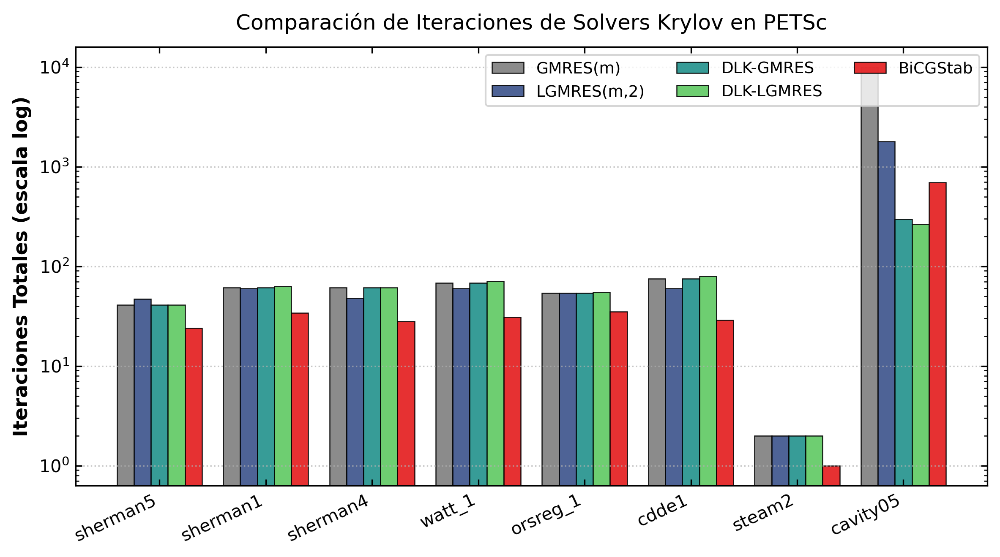
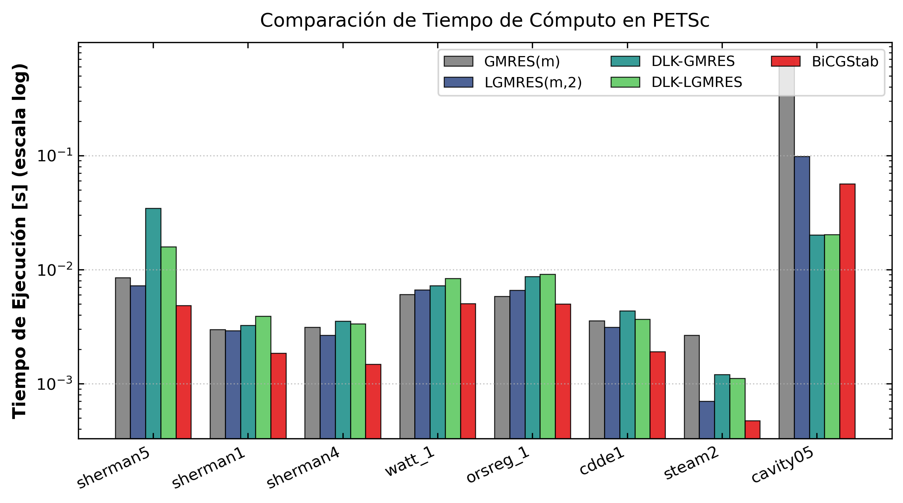
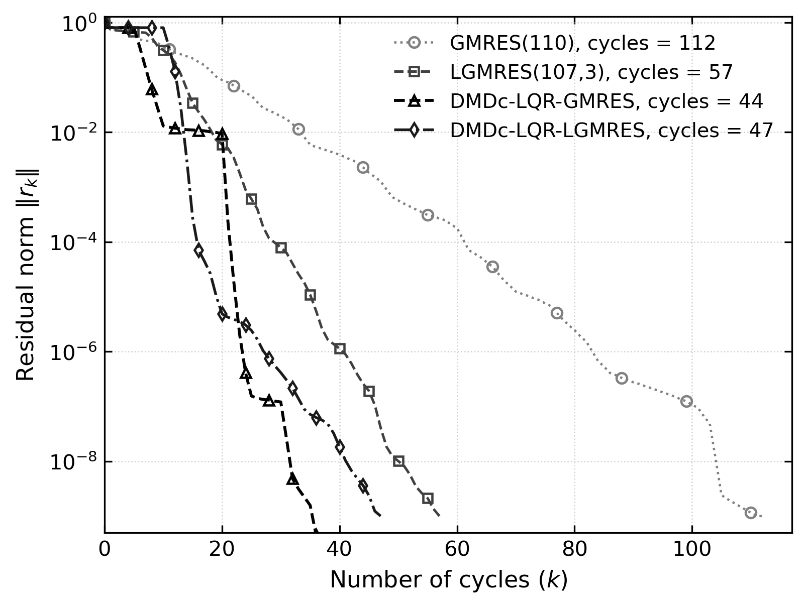
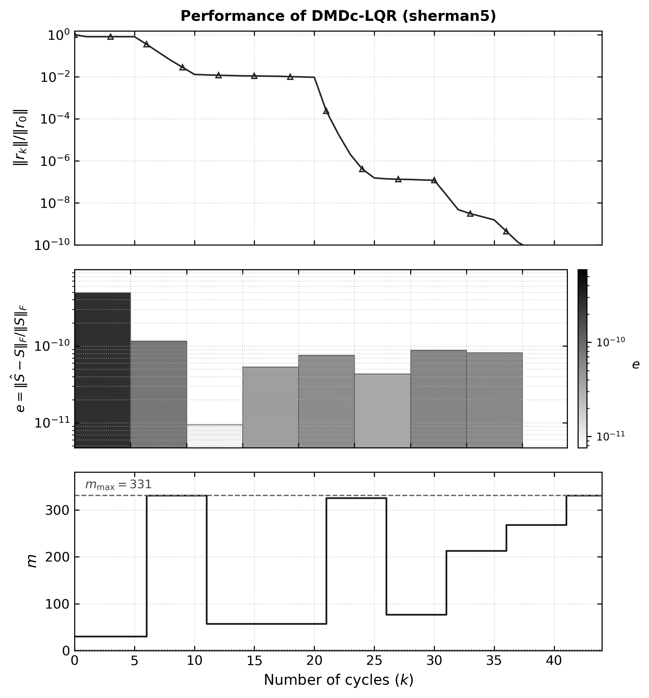

# DLK-rest: Solvers Krylov con Reinicio Adaptativo (DMDc-LQR) en PETSc

[](https://en.wikipedia.org/wiki/C11_(C_standard_revision))
[](https://petsc.org/)
[](https://www.open-mpi.org/)
[](http://www.netlib.org/lapack/)
[](LICENSE)

Implementación nativa, modular y de alto rendimiento en **PETSc (C / MPI)** de la familia de solucionadores de subespacios de Krylov con reinicio adaptativo basados en control óptimo y modelado reducido impulsado por datos, correspondiente a la investigación:

> **"Optimal Control for Restarting Minimal Residual Krylov Solvers via Data-Driven Residual Dynamics"**  
> *Carlos Benitez, Juan C. Cabral, Christian E. Schaerer.*

---

## 1. Motivación y Fundamento Teórico

El método de residuo mínimo generalizado con reinicio, **$\text{GMRES}(m)$**, enfrenta un dilema fundamental en sistemas lineales de gran escala $A x = b$:
* **Valores pequeños de $m$:** Bajo coste computacional y de memoria por ciclo, pero alto riesgo de **estancamiento severo** o convergencia lenta.
* **Valores grandes de $m$:** Mayor probabilidad de convergencia, pero a costa de un **crecimiento cuadrático en ortogonalizaciones** y almacenamiento en memoria ($m$ vectores de dimensión $N$).

### La Solución DLK (Dynamic Mode Decomposition with Control)
En lugar de fijar un parámetro estático $m$ o recurrir a heurísticas ad-hoc, el método **DLK**:
1. Recolecta una ventana deslizante de $p$ snapshots normalizados del residuo $r_k = b - A x_k$.
2. Aplica **DMDc (Dynamic Mode Decomposition with Control)** para identificar un modelo lineal en espacio de estados de orden reducido:
   $$\hat{x}_{k+1} = \bar{H} \hat{x}_k + \bar{B} u_k$$
   donde la variable de control $u_k = m_k$ es la dimensión del subespacio Krylov para el siguiente ciclo.
3. Resuelve una **Ecuación Algebraica de Riccati en Tiempo Continuo (CARE)** mediante el formalismo LQR sobre el subespacio controlable:
   $$\bar{H}^T P + P \bar{H} - P \bar{B} R^{-1} \bar{B}^T P + Q = 0, \quad K = R^{-1} \bar{B}^T P$$
4. Selecciona de forma óptima y adaptativa el parámetro de reinicio $m_{k+1}$ acotado en $[m_{\min}, m_{\max}]$, rompiendo mesetas de convergencia con el menor coste computacional.

El paquete implementa tanto la variante estándar **`DLK-GMRES`** como la variante enriquecida con aproximaciones de error acumuladas **`DLK-LGMRES`**.

---

## 2. Arquitectura del Repositorio

El proyecto sigue una arquitectura desacoplada y ordenada:

```text
DLK-rest/
├── README.md                      <- Documentación general del proyecto
├── Makefile                       <- Build system compatible con variables de entorno PETSc
├── include/                       <- Encabezados públicos e internos en C
│   ├── petsckspdlk.h              <- API pública de PETSc para KSPDLK y KSPDLKLGMRES
│   ├── kspdlkimpl.h               <- Estructuras internas de datos del solver KSP
│   └── dmdc_lqr.h                 <- Rutinas de álgebra lineal, SVD y CARE (Riccati)
├── src/                           <- Implementación del núcleo computacional
│   ├── kspdlk.c                   <- Ciclo de vida PETSc (Create, SetUp, Solve, Destroy)
│   └── dmdc_lqr.c                 <- Identificación DMDc y controlador LQR en C/LAPACK
├── data/                          <- Conjunto de matrices dispersas de prueba
│   ├── README.md                  <- Documentación detallada del dataset y formatos
│   ├── convert_mat_to_bin.py      <- Script para serializar .mat a .bin de PETSc
│   ├── bin/                       <- 22 matrices en formato binario PETSc (.bin)
│   ├── mat_collection_test/       <- Conjunto básico de matrices (.mat)
│   └── mat_collection_test_full/  <- Colección completa SuiteSparse (.mat)
├── scripts/                       <- Herramientas de benchmark y visualización para publicación
│   ├── run_benchmark_comparison.py<- Ejecución automatizada de la suite sobre matrices
│   ├── plot_benchmark_bars.py     <- Gráficos de barras comparativos (Iteraciones y Tiempo)
│   ├── plot_comparison_of_methods.py <- Curvas comparativas de convergencia estilo SIAM
│   └── plot_performance_with_m.py <- Curvas de rendimiento en 3 paneles (Residuo, Error DMDc, m)
├── tests/                         <- Drivers de prueba y scripts de validación
│   └── test_dlk.c                 <- Programa principal de ejecución y benchmark
└── results/                       <- Resultados experimentales y figuras
    ├── README.md                  <- Guía de ejecución con cualquier matriz y detalles CLI
    ├── figures/                   <- Figuras para publicación en formato PNG (300 DPI) y EPS
    └── tables/                    <- Tablas comparativas en formato CSV y Markdown
```

---

## 3. Requisitos y Compilación

### Requisitos del Sistema
* **Compilador C:** GCC 9+ / Clang 11+ compatible con C11.
* **PETSc:** Versión 3.20 o superior configurada con soporte para números reales (`--with-scalar-type=real`).
* **Librerías BLAS/LAPACK:** OpenBLAS, Intel MKL o Netlib LAPACK.
* **MPI:** OpenMPI o MPICH.
* **Python 3:** (Para scripts de datos y figuras) `scipy`, `numpy`, `matplotlib`.

### Compilación
```bash
# Compilar el ejecutable test_dlk:
make clean && make
```
El `Makefile` detecta automáticamente la instalación de PETSc mediante `pkg-config` o variables de entorno del sistema (`PETSC_DIR` / `PETSC_ARCH`).

---

## 4. Guía de Uso del Solver

Los solvers se integran de forma nativa en el sistema de opciones de PETSc mediante el prefijo `-ksp_dlk_*`:

### Solvers Registrados (`-ksp_type`)
* **`dlk`**: GMRES con adaptación dinámica de $m$ vía DMDc-LQR o PD.
* **`dlk_lgmres`**: LGMRES adaptativo que combina subespacio Krylov de tamaño variable con $\ell$ vectores de enriquecimiento.

### Opciones de la Línea de Comandos

| Opción CLI | Tipo | Defecto | Descripción |
| :--- | :---: | :---: | :--- |
| `-matrix <path.bin>` | String | Requerido | Archivo binario PETSc con matriz $A$ y vector $b$. |
| `-ksp_type <tipo>` | String | `dlk` | Solver: `dlk`, `dlk_lgmres`, `gmres`, `lgmres`, `bcgs`. |
| `-ksp_dlk_controller` | Enum | `lqr` | Algoritmo de control: `lqr`, `pd`, `none`. |
| `-ksp_dlk_m0` | Entero | `30` | Dimensión de reinicio inicial ($m_0$). |
| `-ksp_dlk_m_min` | Entero | `2` | Cota mínima permitida para $m$. |
| `-ksp_dlk_m_max` | Entero | `60` | Cota máxima permitida para $m$. |
| `-ksp_dlk_alpha` | Real | `1e-4` | Penalización $\alpha$ en CARE ($R = \alpha I$). |
| `-ksp_dlk_aug` | Entero | `2` | Número de vectores de enriquecimiento $\ell$ (en `dlk_lgmres`). |
| `-pc_type <tipo>` | String | `ilu` | Precondicionador: `ilu`, `none`, `jacobi`, `bjacobi`. |
| `-tol <val>` | Real | `1e-8` | Tolerancia de convergencia relativa $\|r_k\|/\|r_0\|$. |
| `-cycle_file <path.csv>` | String | Opcional | Exporta historial de ciclos ($m$, residuo relativo, error DMDc). |

---

## 5. Ejemplos de Ejecución Rápida

### A. Ejecutar Sherman5 con DLK-GMRES Adaptativo (Sin Precondicionador)
```bash
./test_dlk -matrix data/bin/sherman5.bin \
           -ksp_type dlk \
           -ksp_dlk_controller lqr \
           -ksp_dlk_m0 30 \
           -ksp_dlk_m_min 30 \
           -ksp_dlk_m_max 331 \
           -ksp_dlk_alpha 0.001 \
           -pc_type none \
           -tol 1e-12 \
           -cycle_file results/tables/cycles_sherman5_dlk.csv
```

### B. Ejecutar Cavity05 con DLK-LGMRES ($\ell = 2$)
```bash
./test_dlk -matrix data/bin/cavity05.bin \
           -ksp_type dlk_lgmres \
           -ksp_dlk_aug 2 \
           -ksp_dlk_m0 20 \
           -ksp_dlk_m_max 118 \
           -pc_type none \
           -tol 1e-8
```

### C. Ejecutar en Paralelo con MPI (4 procesos)
```bash
mpirun -np 4 ./test_dlk -m 80 -n 80 -ksp_type dlk_lgmres -ksp_dlk_controller lqr -pc_type bjacobi
```

---

## 6. Resultados Experimentales y Benchmarks

### Tabla Resumen del Benchmark (`results/tables/benchmark_comparison.md`)

Resultados obtenidos evaluando los solucionadores en matrices de la colección SuiteSparse:

| Matriz | Dimensión ($N$) | Solver | Iteraciones | Tiempo (s) | Residuo $\|b-Ax\|$ | Estado |
| :--- | :---: | :--- | :---: | :---: | :---: | :--- |
| `cavity05` | 1,182 | GMRES(20) | 10,000 | 0.6803 | $1.50 \times 10^{-16}$ | Estancado |
| `cavity05` | 1,182 | LGMRES(20,2) | 1,796 | 0.0984 | $1.04 \times 10^{-19}$ | Convergió |
| `cavity05` | 1,182 | **DLK-GMRES** | **297** | **0.0202** | $4.51 \times 10^{-15}$ | **Aceleración 34x** |
| `cavity05` | 1,182 | **DLK-LGMRES** | **264** | **0.0203** | $5.62 \times 10^{-15}$ | **Óptimo** |
| `sherman1` | 1,000 | DLK-GMRES | 61 | 0.0032 | $2.82 \times 10^{-8}$ | Convergió |
| `sherman4` | 1,104 | DLK-LGMRES | 61 | 0.0034 | $9.06 \times 10^{-7}$ | Convergió |
| `watt_1` | 1,856 | DLK-GMRES | 68 | 0.0072 | $9.40 \times 10^{-7}$ | Convergió |
| `cdde1` | 961 | DLK-GMRES | 75 | 0.0043 | $5.03 \times 10^{-7}$ | Convergió |

*(La tabla completa y el archivo CSV se encuentran en [`results/tables/benchmark_comparison.csv`](file:///home/carlos_benitez/DLK-rest/results/tables/benchmark_comparison.csv))*.

---

## 7. Figuras Comparativas para Publicación

Todas las gráficas se generan automáticamente en formato vectorial EPS (para inclusión en LaTeX) y PNG a 300 DPI:

### A. Gráfico de Barras Comparativo de Rendimiento
Generado a partir del CSV con `python3 scripts/plot_benchmark_bars.py`:




### B. Curvas de Convergencia Estilo SIAM (`sherman5`)
Generada con `python3 scripts/plot_comparison_of_methods.py`:



### C. Rendimiento Multietapa y Dinámica de $m$ (`sherman5`)
Generada con `python3 scripts/plot_performance_with_m.py`:



---

## 8. Reproducibilidad Automatizada

Para reproducir todos los experimentos y actualizar tablas y gráficas desde cero:

```bash
# 1. Compilar el binario C:
make clean && make

# 2. Convertir y verificar el dataset de matrices:
python3 data/convert_mat_to_bin.py

# 3. Ejecutar el benchmark comparativo completo:
python3 scripts/run_benchmark_comparison.py

# 4. Generar los gráficos de barras comparativos:
python3 scripts/plot_benchmark_bars.py

# 5. Generar las curvas de convergencia SIAM para sherman5:
python3 scripts/plot_comparison_of_methods.py
python3 scripts/plot_performance_with_m.py \
    --cycle_file results/tables/cycles_sherman5_dlk.csv \
    --output_prefix results/figures/PerformanceofDMDcLQRGMRESmsherman5_with_m \
    --m_max 331 --m_min 30
```

---

## 9. Cita y Referencia Académica

Si utilizas este software o los algoritmos DLK-GMRES / DLK-LGMRES en tus investigaciones, por favor cita:

```bibtex
@article{benitez2026dlk,
  title   = {Optimal Control for Restarting Minimal Residual Krylov Solvers via Data-Driven Residual Dynamics},
  author  = {Benitez, Carlos and Cabral, Juan C. and Schaerer, Christian E.},
  journal = {arXiv preprint},
  year    = {2026}
}
```
