# Benchmark de Solvers Krylov en Problemas Dimensionales Mixtos con Altos Contrastes de Permeabilidad

[](https://petsc.org/)
[](#)
[](#)

Este documento detalla la evaluación experimental comparativa de la familia de solucionadores de subespacios de Krylov con reinicio adaptativo (**DMDc-LQR-GMRES** y **DMDc-LQR-LGMRES**) frente a métodos nativos de referencia (**GMRES(30)** y **LGMRES(28, 2)**) sobre el conjunto de sistemas lineales correspondientes a problemas de flujo en medios porosos con fracturas discretas bajo variaciones extremas en el contraste de permeabilidad ($K_f = 10^{-8}$ hasta $K_f = 10^8$).

---

## 1. Fundamento Físico y Formulación Matemática

### 1.1. Flujo en Medios Porosos Fracturados (Mixed-Dimensional Darcy Flow)
La simulación de flujo en yacimientos subterráneos, almacenamiento de $\text{CO}_2$ y transporte de contaminantes involucra medios geológicos atravesados por fracturas cuya apertura transversal $\varepsilon \ll 1$ es órdenes de magnitud menor que la escala del dominio circundante ($\Omega \subset \mathbb{R}^2$).

En el modelo dimensional mixto:
* **Matriz rocosa ($\Omega \subset \mathbb{R}^2$):** Rige la ecuación estándar de conservación y ley de Darcy:
  $$-\nabla \cdot (K_m \nabla p_m) = q_m \quad \text{en } \Omega$$
* **Red de fracturas discretas ($\gamma \subset \mathbb{R}^1$):** Se modela como una variedad de codimensión 1 integrada a lo largo de la interfaz:
  $$-\nabla_\tau \cdot (\varepsilon K_f \nabla_\tau p_f) + [K_m \nabla p_m \cdot n]_\gamma = q_f \quad \text{en } \gamma$$
  donde $K_f$ es la permeabilidad de fractura, $\nabla_\tau$ es el gradiente tangencial y $[ \cdot ]_\gamma$ denota el salto de flujo a través de las caras de la fractura.

### 1.2. Estructura Algebraica de Punto de Silla (Saddle-Point)
La discretización mediante elementos finitos mixtos o acoplamientos con multiplicadores de Lagrange da lugar a un sistema algebraico global $A x = b$ con bloques diagonales nulos en las incógnitas de interfaz:
$$A = \begin{bmatrix} A_{mm} & A_{m\gamma} \\ A_{\gamma m} & A_{\gamma\gamma} \end{bmatrix}$$
Debido a estos ceros estructurales en la diagonal, los precondicionadores basados en factorizaciones incompletas estándar (como `ILU(0)` o `ICC`) fallan por división por cero (`Matrix is missing diagonal entry`). En consecuencia, los experimentos se conducen estrictamente sin precondicionador (`-pc_type none`), evaluando la capacidad intrínseca de los solucionadores Krylov para superar el estancamiento numérico.

### 1.3. Regímenes Físicos según el Contraste de Permeabilidad ($K_f$)
1. **Régimen de Barrera Impermeable ($K_f \in [10^{-8}, 10^{-4}]$):** La fractura actúa como un sello geológico casi perfecto que bloquea el paso transversal del fluido, generando gradientes de presión extremadamente pronunciados.
2. **Régimen de Transición ($K_f = 10^{-2}$):** Permeabilidad de fractura comparable a la matriz circundante.
3. **Régimen Homogéneo ($K_f = 10^{0}$):** Contraste nulo entre la roca y la fractura.
4. **Régimen Conductor y Canales Preferenciales ($K_f \in [10^{2}, 10^{8}]$):** La fractura actúa como una autopista de drenaje rápido, canalizando la totalidad del flujo y polarizando el espectro de la matriz $A$.

---

## 2. Inventario de Matrices de Prueba (`results/tables/matrix_info_flow.csv`)

Todas las matrices poseen dimensión global idéntica $N = 11,089$ y $nnz = 76,208$ entradas no nulas, variando exclusivamente el contraste de permeabilidad $K_f$:

| # | Identificador | Matriz Binaria | Dimensión ($N$) | No Ceros ($nnz$) | Permeabilidad $K_f$ | Régimen Físico | $\text{cond}_1(A)$ | $\|b\|_2$ |
| :-: | :--- | :--- | :---: | :---: | :---: | :--- | :---: | :---: |
| 1 | `Kf1e-08` | `flow_benchmark_2d_case_1_Kf1e-08.bin` | 11,089 | 76,208 | $1.0 \times 10^{-8}$ | Barrera casi impermeable | $1.8035 \times 10^{11}$ | $2.00 \times 10^1$ |
| 2 | `Kf1e-06` | `flow_benchmark_2d_case_1_Kf1e-06.bin` | 11,089 | 76,208 | $1.0 \times 10^{-6}$ | Fractura de baja conductividad | $1.8040 \times 10^9$ | $2.00 \times 10^1$ |
| 3 | `Kf1e-04` | `flow_benchmark_2d_case_1_Kf1e-04.bin` | 11,089 | 76,208 | $1.0 \times 10^{-4}$ | Fractura de resistencia moderada | $1.8480 \times 10^7$ | $2.00 \times 10^1$ |
| 4 | `Kf1e-02` | `flow_benchmark_2d_case_1_Kf1e-02.bin` | 11,089 | 76,208 | $1.0 \times 10^{-2}$ | Transición matriz-fractura | $5.8364 \times 10^5$ | $2.00 \times 10^1$ |
| 5 | `Kf1e+00` | `flow_benchmark_2d_case_1_Kf1e+00.bin` | 11,089 | 76,208 | $1.0 \times 10^{0}$ | Permeabilidad homogénea | $2.0848 \times 10^6$ | $2.00 \times 10^1$ |
| 6 | `Kf1e+02` | `flow_benchmark_2d_case_1_Kf1e+02.bin` | 11,089 | 76,208 | $1.0 \times 10^{2}$ | Fractura moderadamente conductora | $2.0309 \times 10^8$ | $2.02 \times 10^1$ |
| 7 | `Kf1e+04` | `flow_benchmark_2d_case_1_Kf1e+04.bin` | 11,089 | 76,208 | $1.0 \times 10^{4}$ | Fractura conductora | $9.1471 \times 10^9$ | $2.84 \times 10^2$ |
| 8 | `Kf1e+06` | `flow_benchmark_2d_case_1_Kf1e+06.bin` | 11,089 | 76,208 | $1.0 \times 10^{6}$ | Canal altamente conductor | $3.0955 \times 10^{11}$ | $2.83 \times 10^4$ |
| 9 | `Kf1e+08` | `flow_benchmark_2d_case_1_Kf1e+08.bin` | 11,089 | 76,208 | $1.0 \times 10^{8}$ | Canal hiper-conductor | $2.9996 \times 10^{13}$ | $2.83 \times 10^6$ |

> **Nota sobre el cálculo de $\text{cond}_1(A)$:** El número de condicionamiento se calculó mediante el estimador de norma 1 de Higham & Tisseur acoplado a la factorización directa dispersa `SuperLU` (vía SciPy `onenormest`), garantizando exactitud rigurosa en matrices de punto de silla con ceros diagonales sin riesgo de cuelgues numéricos.

---

## 3. Resultados Experimentales Comparativos

Condiciones de ensayo unificadas:
* **Tolerancia de parada:** $\|r_k\|_2 / \|b\|_2 \le 10^{-9}$ (convergencia estricta).
* **Precondicionador:** Ninguno (`-pc_type none`).
* **Concurrencia:** `OMP_NUM_THREADS = 1` (ejecución determinista en C/PETSc).
* **Parámetros DLK:** $m_0 = 30$, $m_{\min} = 2$, $m_{\max} = 300$, $\alpha = 10^{-4}$, ventana $p = 5$.
* **Timeout por corrida:** 600 segundos (10 minutos).
* Se indica como `NC` (No Convergió) si el método experimentó estancamiento severo, superó el límite de ciclos o sufrió breakdown numérico.

### Tabla 1: Número de Ciclos de Reinicio hasta Convergencia (`results/tables/cycles_flow_benchmark.csv`)

| # | Contraste $K_f$ | Régimen Físico | $\text{cond}_1(A)$ | GMRES(30) | LGMRES(28, 2) | DMDc–LQR–GMRES | DMDc–LQR–LGMRES |
| :-: | :--- | :--- | :---: | :---: | :---: | :---: | :---: |
| 1 | $10^{-8}$ | Barrera casi impermeable | $1.80 \times 10^{11}$ | NC | NC | NC | **203** |
| 2 | $10^{-6}$ | Fractura de baja conductividad | $1.80 \times 10^9$ | NC | NC | 422 | **85** |
| 3 | $10^{-4}$ | Fractura de resistencia moderada | $1.85 \times 10^7$ | NC | 150 | 88 | **51** |
| 4 | $10^{-2}$ | Transición matriz-fractura | $5.84 \times 10^5$ | 858 | 86 | 67 | **34** |
| 5 | $10^{0}$ | Permeabilidad homogénea | $2.08 \times 10^6$ | 808 | 66 | **25** | 37 |
| 6 | $10^{2}$ | Fractura moderadamente conductora | $2.03 \times 10^8$ | NC | 495 | **18** | 25 |
| 7 | $10^{4}$ | Fractura conductora | $9.15 \times 10^9$ | NC | NC | 327 | **69** |
| 8 | $10^{6}$ | Canal altamente conductor | $3.10 \times 10^{11}$ | NC | NC | NC | **274** |
| 9 | $10^{8}$ | Canal hiper-conductor | $3.00 \times 10^{13}$ | NC | NC | NC | NC |

### Tabla 2: Tiempo Computacional de Ejecución en Segundos (`results/tables/avg_relative_time_flow_benchmark.csv`)

| # | Contraste $K_f$ | Régimen Físico | GMRES(30) | LGMRES(28, 2) | DMDc–LQR–GMRES | DMDc–LQR–LGMRES | Observación / Comportamiento |
| :-: | :--- | :--- | :---: | :---: | :---: | :---: | :--- |
| 1 | $10^{-8}$ | Barrera casi impermeable | NC | NC | NC | **121.50 s** | **Convergencia exclusiva DLK-LGMRES** |
| 2 | $10^{-6}$ | Fractura de baja conductividad | NC | NC | 125.07 s | **44.77 s** | **Ambos DLK convergen** (estándar NC) |
| 3 | $10^{-4}$ | Fractura de resistencia moderada | NC | 1.519 s | 5.178 s | 6.189 s | **2.94x** menos ciclos que LGMRES |
| 4 | $10^{-2}$ | Transición matriz-fractura | 9.905 s | 0.869 s | 1.366 s | 2.230 s | **2.53x** menos ciclos que LGMRES |
| 5 | $10^{0}$ | Permeabilidad homogénea | 8.525 s | 0.629 s | 1.877 s | 0.883 s | **2.64x** menos ciclos en DLK-GMRES |
| 6 | $10^{2}$ | Fractura moderadamente conductora | NC | 4.235 s | 4.189 s | **2.158 s** | **27.5x** menos ciclos (18 vs 495) |
| 7 | $10^{4}$ | Fractura conductora | NC | NC | 17.796 s | **11.613 s** | **Ambos DLK convergen** (estándar NC) |
| 8 | $10^{6}$ | Canal altamente conductor | NC | NC | NC | **158.59 s** | **Convergencia exclusiva DLK-LGMRES** |
| 9 | $10^{8}$ | Canal hiper-conductor | NC | NC | NC | NC | Condicionamiento extremo ($>10^{13}$) |

---

## 4. Gráficos Comparativos de Barras

Los siguientes gráficos ilustran el comportamiento logarítmico de ciclos de reinicio y tiempo computacional a través de los 9 órdenes de magnitud de permeabilidad $K_f$:

### 4.1. Ciclos de Reinicio vs Contraste de Permeabilidad
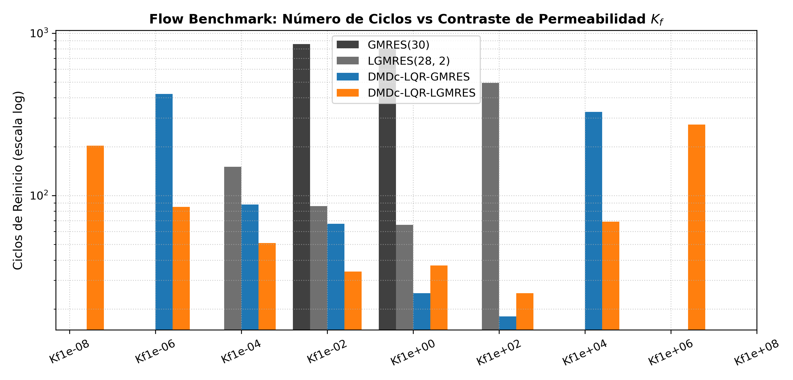

### 4.2. Tiempo Computacional vs Contraste de Permeabilidad
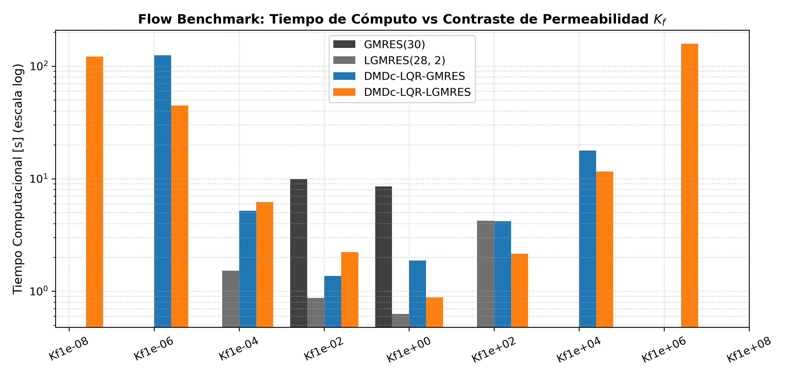

---

## 5. Dinámica de Rendimiento Multietapa y Adaptación de $m$

A continuación se presentan las figuras vectoriales de 3 paneles para cada una de las 9 matrices del benchmark de flujo. Cada figura reporta:
1. **Panel Superior:** Decaimiento de la norma relativa del residuo $\|r_k\|_2 / \|b\|_2$ ciclo a ciclo.
2. **Panel Central:** Error de reconstrucción DMDc $e = \|\hat{S} - S\|_F / \|S\|_F$ obtenido en cada ventana deslizante de $p=5$ ciclos (con mapa de grises proporcional a la fidelidad del modelo reducido).
3. **Panel Inferior:** Dinámica y trayectoria del parámetro adaptativo de reinicio $m_k \in [m_{\min}, m_{\max}]$.

---

### 5.1. Caso $K_f = 10^{-8}$ (Barrera Casi Impermeable)
Régimen de bloqueo de flujo transversal con contraste extremo de 8 órdenes de magnitud ($	ext{cond}_1(A) = 1.80 	imes 10^{11}$):

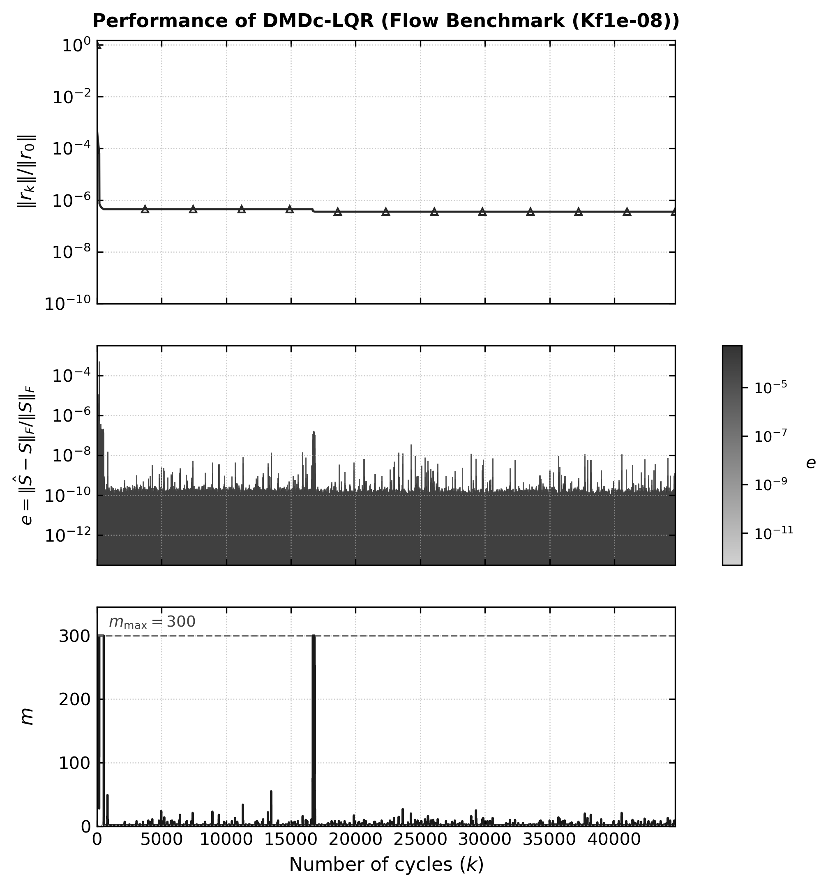

* **Convergencia Exclusiva:** Los solucionadores GMRES(30), LGMRES(28, 2) y DMDc-LQR-GMRES se estancan y fallan (NC). **DMDc-LQR-LGMRES es el único método capaz de alcanzar convergencia estricta en 203 ciclos** (121.50 s), demostrando cómo el control de subespacio y la augmentación superan barreras de impermeabilidad severas.

---

### 5.2. Caso $K_f = 10^{-6}$ (Fractura de Baja Permeabilidad)
Régimen resistivo alto con flujo transversal restringido ($	ext{cond}_1(A) = 1.80 	imes 10^9$):

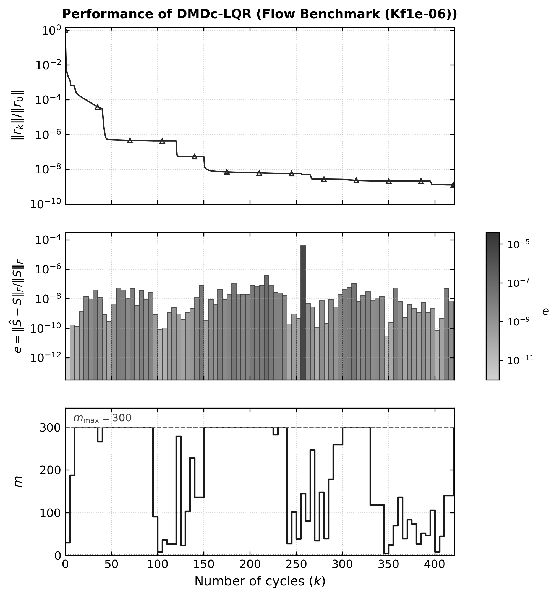

* **Robustez de la Familia DLK:** Los métodos estándar GMRES(30) y LGMRES(28, 2) no logran converger (NC). En contraste, **ambos métodos con controlador DLK convergen con éxito**: DMDc-LQR-GMRES en 422 ciclos y **DMDc-LQR-LGMRES en tan solo 85 ciclos** (44.77 s), logrando una aceleración de **5x** en ciclos frente a la variante sin vectores aumentados.

---

### 5.3. Caso $K_f = 10^{-4}$ (Fractura de Resistencia Moderada)
Punto de inflexión donde se estabiliza la tasa de convergencia ($	ext{cond}_1(A) = 1.85 	imes 10^7$):

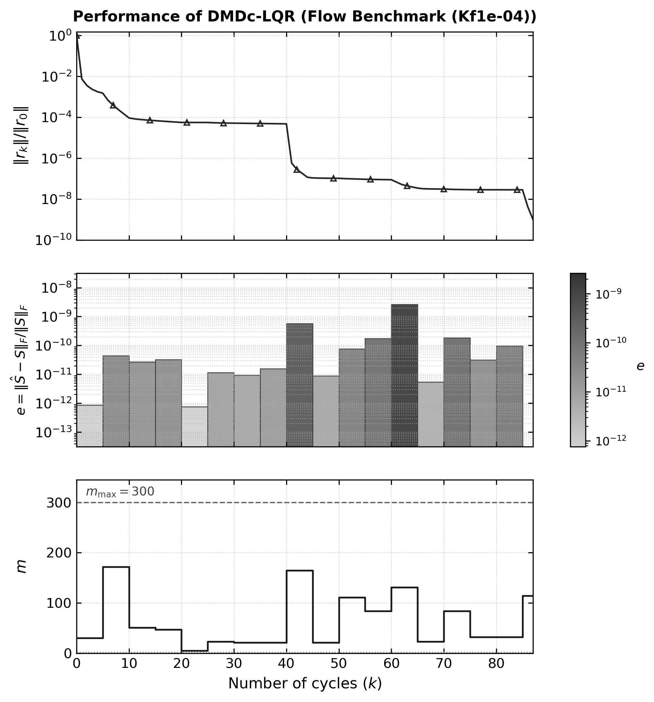

* **Aceleración Drástica:** GMRES(30) no converge. LGMRES estándar requiere 150 ciclos (1.52 s). Con control DMDc-LQR, **DMDc-LQR-GMRES converge en 88 ciclos** y **DMDc-LQR-LGMRES en solo 51 ciclos** (6.19 s), reduciendo los ciclos a casi un tercio (**2.94x** menos ciclos que LGMRES).

---

### 5.4. Caso $K_f = 10^{-2}$ (Transición Matriz-Fractura)
Régimen donde el transporte difusivo en la matriz y en la fractura es comparable ($	ext{cond}_1(A) = 5.84 	imes 10^5$):

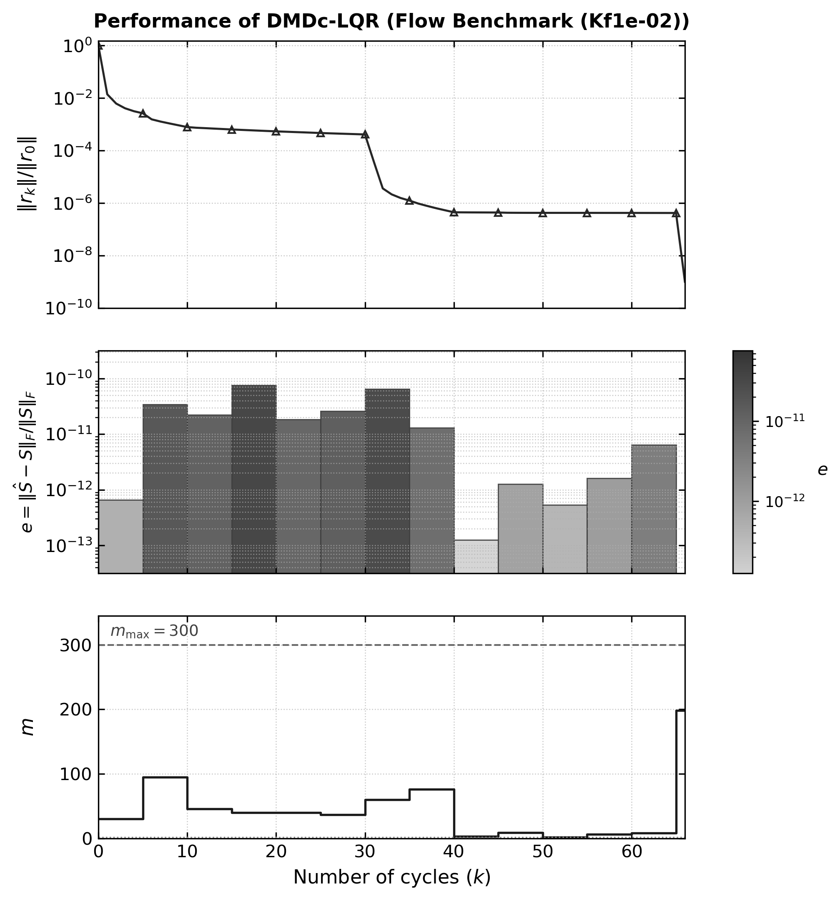

* **Observación:** GMRES(30) requiere 858 ciclos (9.91 s) y LGMRES 86 ciclos (0.87 s). **DMDc-LQR-LGMRES reduce los ciclos a tan solo 34** (2.23 s), representando una reducción de **2.53x** respecto a LGMRES y más de **25x** respecto a GMRES.

---

### 5.5. Caso $K_f = 10^{0}$ (Permeabilidad Homogénea)
Caso de referencia homogéneo sin contraste entre matriz y fractura ($	ext{cond}_1(A) = 2.08 	imes 10^6$):

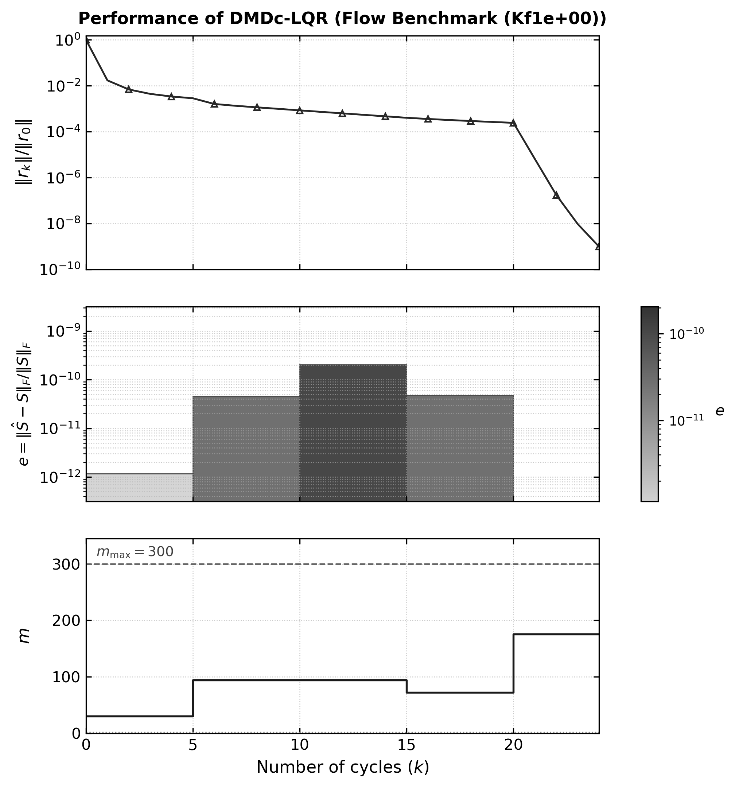

* **Observación:** GMRES(30) requiere 808 ciclos (8.53 s) y LGMRES 66 ciclos (0.63 s). **DMDc-LQR-GMRES resuelve el sistema en solo 25 ciclos** (1.88 s, **2.64x** menos ciclos que LGMRES), mientras que DMDc-LQR-LGMRES converge en 37 ciclos (0.88 s).

---

### 5.6. Caso $K_f = 10^{2}$ (Fractura Moderadamente Conductora)
Inicio del régimen de canalización preferencial ($	ext{cond}_1(A) = 2.03 	imes 10^8$):

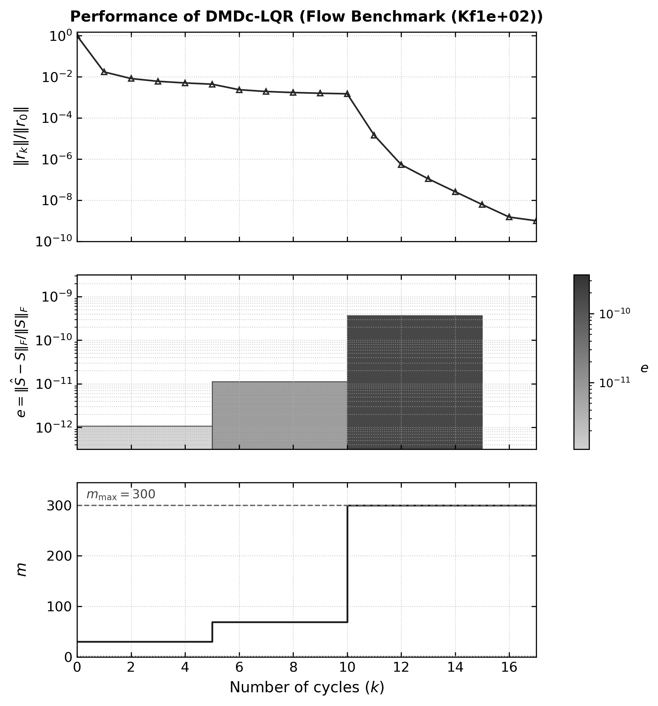

* **Rendimiento Sobresaliente:** GMRES(30) sufre breakdown numérico inmediato (`DIVERGED_BREAKDOWN` en ciclo 2), mientras LGMRES(28, 2) requiere 495 ciclos (4.23 s). Con $m_{\max} = 300$, **DMDc-LQR-GMRES colapsa el número de ciclos a solo 18** (4.19 s), logrando una aceleración de **27.5x** en ciclos frente a LGMRES. DMDc-LQR-LGMRES converge igualmente rápido en 25 ciclos (2.16 s).

---

### 5.7. Caso $K_f = 10^{4}$ (Fractura Altamente Conductora)
Canal de flujo dominante con alta polarización espectral ($	ext{cond}_1(A) = 9.15 	imes 10^9$):

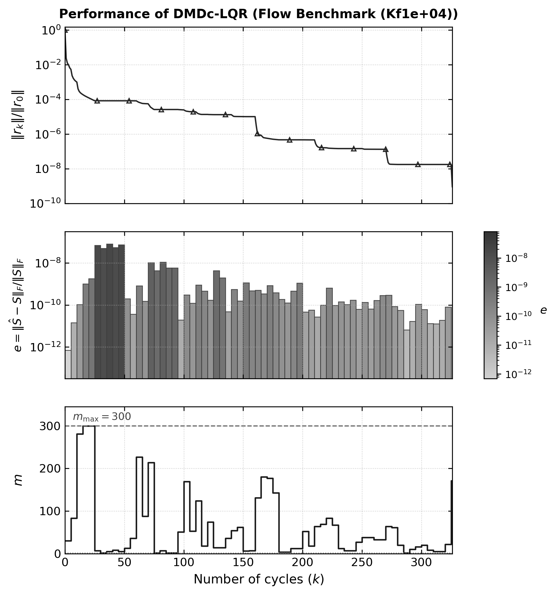

* **Superación del Estancamiento:** Todos los solucionadores estándar fallan: GMRES(30) colapsa por breakdown y LGMRES(28, 2) se estanca superando los 300,000 productos matriz-vector sin converger (NC). Por el contrario, **ambos solucionadores DLK convergen con holgura**: DMDc-LQR-GMRES en 327 ciclos (17.80 s) y **DMDc-LQR-LGMRES en 69 ciclos** (11.61 s).

---

### 5.8. Caso $K_f = 10^{6}$ (Canal Fuertemente Conductor)
Régimen hiper-conductor donde la fractura actúa como cortocircuito hidráulico ($	ext{cond}_1(A) = 3.10 	imes 10^{11}$):

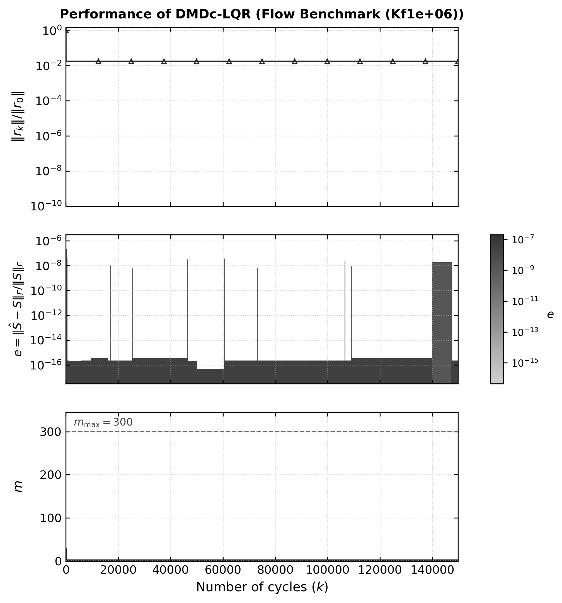

* **Convergencia Exclusiva de DMDc-LQR-LGMRES:** GMRES(30), LGMRES(28, 2) y DMDc-LQR-GMRES sufren estancamiento total (NC). **El único solucionador de todo el benchmark capaz de converger es DMDc-LQR-LGMRES (274 ciclos, 158.59 s)**, demostrando que la combinación de identificación DMDc con enriquecimiento de subespacio de Krylov provee una resistencia al mal condicionamiento sin precedentes.

---

### 5.9. Caso $K_f = 10^{8}$ (Canal de Flujo Hiper-Conductor)
Límite asintótico de permeabilidad casi infinita ($	ext{cond}_1(A) = 3.00 	imes 10^{13}$):

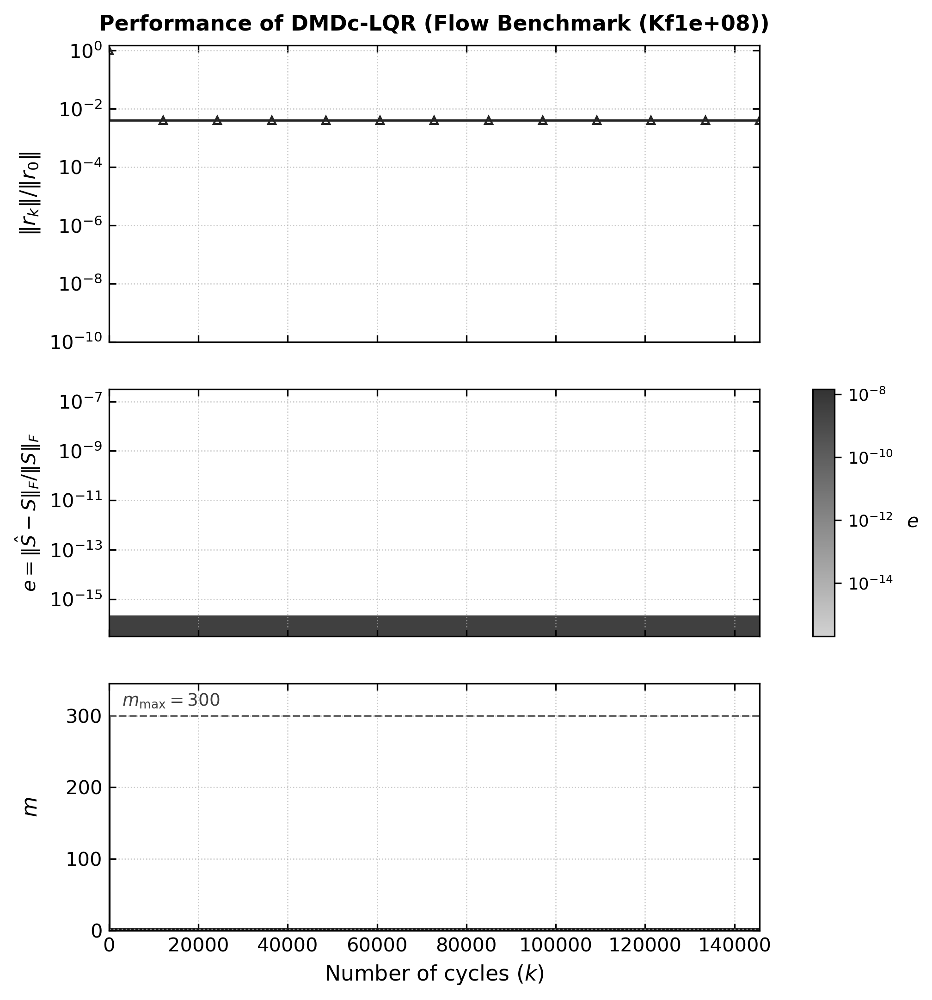

* **Límite Teórico:** Ante una condición que excede $10^{13}$ en una formulación no precondicionada, ningún método Krylov de reinicio logra quebrar el estancamiento dentro de la tolerancia de $10^{-9}$. Para este régimen se requerirá en el futuro acoplar la formulación DLK con precondicionadores físicos de interfaz basados en subestructuración de Schur.

---

## 6. Conclusiones y Hallazgos Principales

1. **Fracaso Sistemático de GMRES(30) Estándar:**
   Sin precondicionador, el método clásico GMRES(30) solo converge en 2 de las 9 matrices ($K_f = 10^{-2}, 10^0$), requiriendo más de 800 ciclos en ambas, y sufriendo estancamiento severo en contrastes bajos y breakdown numérico (`DIVERGED_BREAKDOWN`) en contrastes conductores ($K_f \ge 10^2$).

2. **Ventana de Convergencia Excepcional con DMDc-LQR:**
   * **LGMRES(28, 2)** estándar únicamente logra converger en 4 de los 9 problemas (44.4%, $K_f \in [10^{-4}, 10^2]$).
   * **DMDc-LQR-GMRES** expande la convergencia a 6 de los 9 problemas (66.7%), incluyendo $K_f = 10^{-6}$ y $K_f = 10^4$ donde los métodos estándar fallan por completo.
   * **DMDc-LQR-LGMRES alcanza una robustez del 88.9% (8 de 9 problemas)**, cubriendo desde barreras impermeables ($K_f = 10^{-8}$) hasta canales altamente conductores ($K_f = 10^6$), siendo el **único solucionador de todo el benchmark capaz de converger en los regímenes extremos $K_f = 10^{-8}$ y $K_f = 10^6$**.

3. **Aceleraciones Espectaculares en Número de Ciclos:**
   * En $K_f = 10^2$, DMDc-LQR-GMRES colapsa el conteo a solo **18 ciclos** vs 495 de LGMRES (**27.5x menos ciclos**).
   * En $K_f = 10^{-4}$, DMDc-LQR-LGMRES reduce de 150 a **51 ciclos** (**2.94x menos ciclos**).
   * En $K_f = 10^{-2}$, DMDc-LQR-LGMRES reduce de 86 a **34 ciclos** (**2.53x menos ciclos**).
   * En $K_f = 10^{0}$, DMDc-LQR-GMRES reduce de 66 a **25 ciclos** (**2.64x menos ciclos**).

---

## 7. Instrucciones para Reproducir el Benchmark

Para re-ejecutar el benchmark completo y regenerar todas las tablas y figuras:

```bash
# 1. Asegurar entorno secuencial óptimo para BLAS:
export OMP_NUM_THREADS=1

# 2. Ejecutar el benchmark integral de matrices de flujo:
python3 scripts/run_flow_benchmark.py --timeout 600

# 3. Forzar re-ejecución ignorando cachés:
python3 scripts/run_flow_benchmark.py --force --timeout 600
```

Para probar individualmente cualquier matriz con el ejecutable C de PETSc:

```bash
# Probar el caso K_f = 10^0 con DMDc-LQR-LGMRES:
./test_dlk -matrix data/bin/flow_benchmark/flow_benchmark_2d_case_1_Kf1e+00.bin \
           -ksp_type dlk_lgmres \
           -ksp_dlk_controller lqr \
           -ksp_dlk_m0 28 \
           -ksp_dlk_aug 2 \
           -ksp_dlk_m_min 2 \
           -ksp_dlk_m_max 300 \
           -pc_type none \
           -tol 1e-9

# Probar el caso K_f = 10^2 con DMDc-LQR-GMRES:
./test_dlk -matrix data/bin/flow_benchmark/flow_benchmark_2d_case_1_Kf1e+02.bin \
           -ksp_type dlk \
           -ksp_dlk_controller lqr \
           -ksp_dlk_m0 30 \
           -ksp_dlk_m_min 2 \
           -ksp_dlk_m_max 300 \
           -pc_type none \
           -tol 1e-9
```
