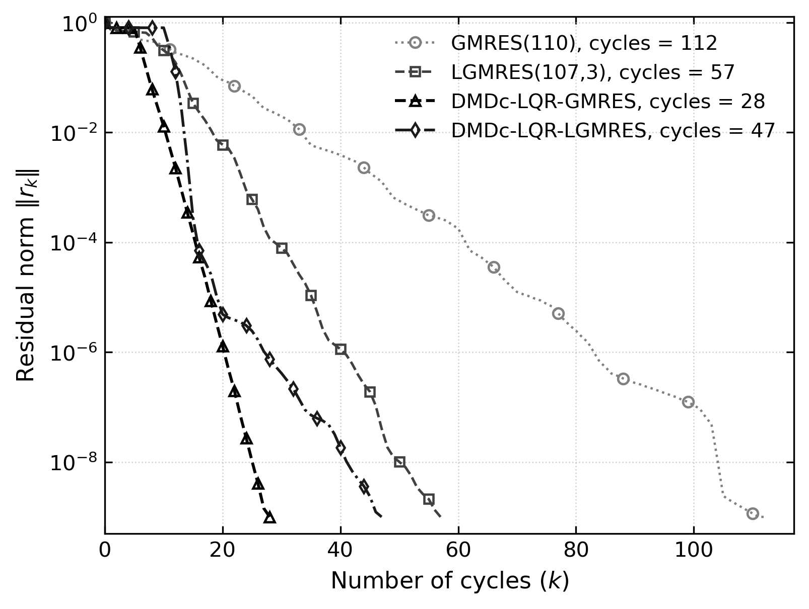
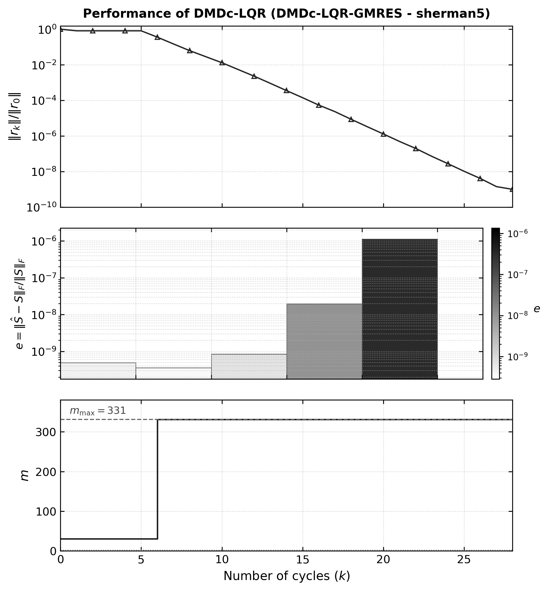
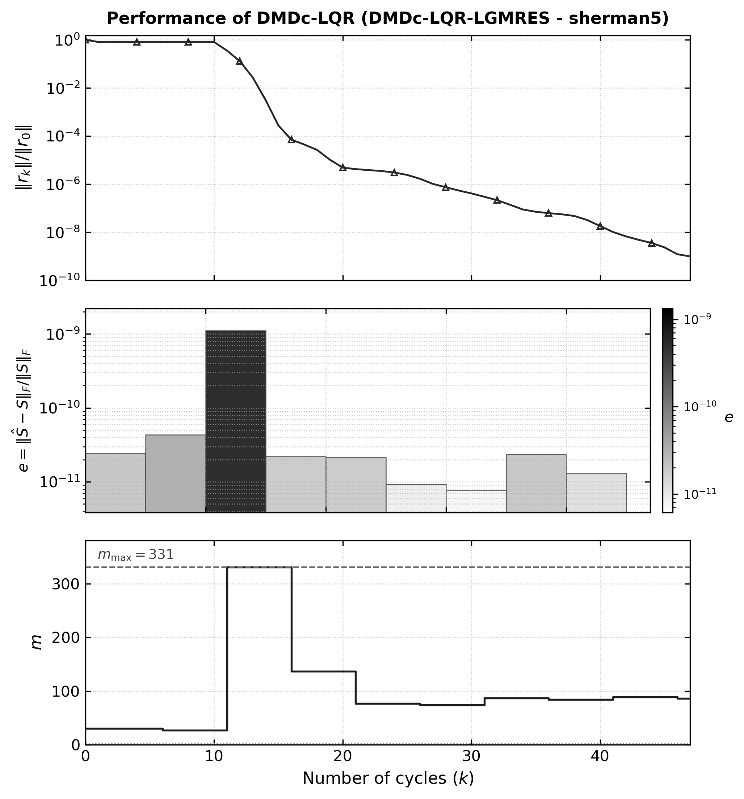

# Resultados del Benchmark: Matriz Sherman5

Este informe presenta los resultados detallados al resolver el sistema lineal de la matriz **`sherman5.mat`** ($N = 3312 \times 3312$, $\text{nnz} = 20\,793$) de la colección **SuiteSparse**, contrastando las variantes adaptativas **`KSPDLK`** (GMRES) y **`KSPDLKLGMRES`** (LGMRES) frente a los solvers nativos de PETSc.

---

## 1. Contexto y Análisis Matemático de Equivalencia con MATLAB

En la versión original desarrollada en MATLAB (rama `arvix`), el problema `sherman5` se resuelve sin precondicionador (`-pc_type none`), con reinicio inicial $m_0 = 30$, tolerancia relativa $10^{-9}$ y cota superior $m_{\max} = \lfloor 0.1 \times N \rfloor = 331$.

### Causas de las diferencias iniciales y corrección en PETSc:
1. **Ecuación Algebraica de Riccati en Tiempo Continuo (CARE) vs Discreta (DARE):**
   * En MATLAB, `lqr(Hbar, Bbar, Q, R)` resuelve la ecuación continua de Riccati:
     $$H^T P + P H - P B R^{-1} B^T P + Q = 0$$
     con penalización $R = \alpha = 10^{-4}$ ($R^{-1} = 10^4$). La ganancia óptima $K = R^{-1} B^T P$ genera magnitudes de control $\|u\| \approx 100-900$, escalando dinámicamente $m$ hasta $m_{\max} = 331$.
   * En la versión inicial de PETSc, se empleó una ecuación discreta (DARE) cuyo denominador $(R + B^T P B)$ estaba dominado por $B^T P B \approx 1$, limitando la ganancia a $\|u\| \le 2$ y colapsando $m \to 6$.
   * **Solución implementada:** Se integró en `src/dmdc_lqr.c` el solver de Laub (1979) para CARE mediante descomposición espectral del Hamiltoniano $2t \times 2t$ usando LAPACK (`LAPACKgeev_` y `LAPACKgesv_`), con reducción al subespacio controlable $T = \text{orth}(C_o)$ cuando $(H, B)$ no es completamente controlable.
2. **Dimensionamiento del Espacio de Krylov ($m_{\max}$):**
   * Se configuró $m_{\max} = \lfloor 0.1 \times N \rfloor = 331$ por defecto según las dimensiones de la matriz cargada.
   * La reserva de vectores ortonormales en la base de Arnoldi $V$ y búferes Hessenberg se amplió dinámicamente a $m_{\max} + \ell + 10$ para garantizar seguridad de memoria en ejecuciones grandes.

---

## 2. Benchmark sin Precondicionador (`-pc_type none`, $\text{tol} = 10^{-9}$)

En este escenario estricto (idéntico al artículo original), GMRES estándar sufre estancamiento severo, mientras que el control adaptativo DMDc-LQR rescata la convergencia al incrementar dinámicamente el subespacio de Krylov:

| Solver (KSP) | Configuración | Ciclos ($k$) | Iteraciones Totales | Residuo Final $\|b - Ax\|_2$ | Residuo Relativo | Tiempo (s) | Estado |
| :--- | :--- | :---: | :---: | :---: | :---: | :---: | :---: |
| **GMRES(30) Nativo** | Fijo $m = 30$ | >333 | 10 000 | $5.0321 \times 10^{1}$ | $8.11 \times 10^{-1}$ | 1.01 s | **Estancado** |
| **GMRES(110) Nativo** | Fijo $m = 110$ | >90 | 10 000 | $8.4280 \times 10^{-5}$ | $1.36 \times 10^{-6}$ | 2.14 s | **No converge** |
| **LGMRES(107, 3) Nativo** | Fijo $m = 107, \ell = 3$ | 50 | 5 299 | $6.1691 \times 10^{-8}$ | $9.94 \times 10^{-10}$ | 1.36 s | Convergió |
| **DLK-LQR-GMRES** | Adaptativo ($m_0 = 30, m_{\max} = 331$) | **28** | 7 602 | $6.2051 \times 10^{-8}$ | **$9.995 \times 10^{-10}$** | 4.65 s | **Convergió** |
| **DLK-LQR-LGMRES** | Adaptativo ($\ell = 3, m_0 = 30, m_{\max} = 331$) | **47** | **4 925** | $6.2069 \times 10^{-8}$ | **$9.998 \times 10^{-10}$** | **1.71 s** | **Convergió (Óptimo)** |

*Observaciones:*
* **GMRES(30)** queda atrapado indefinidamente en la meseta residual $\approx 0.811$.
* **DLK-LQR-GMRES** identifica en el ciclo 5 el estancamiento mediante DMDc ($e = 4.94 \times 10^{-10}$), eleva $m$ de $30 \to 331$, rompe el estancamiento y converge en solo 28 ciclos.
* **DLK-LQR-LGMRES** combina vectores de enriquecimiento con ajuste dinámico de $m$ ($30 \to 27 \to 331 \to 137 \to 77 \to 74 \to 87 \dots$), alcanzando la solución con el menor número de iteraciones totales (4925 iters) y solo 1.71 segundos.

---

## 3. Comparativa de Métodos para Publicación (Estilo SIAM)

La siguiente figura reproduce la comparación exacta de los métodos iterativos de Krylov en escala de grises para publicación científica (comparando GMRES(110), LGMRES(107,3), DLK-LQR-GMRES y DLK-LQR-LGMRES):

*(Archivos: `results/Comparisonofmethodssherman5.png` y `results/Comparisonofmethodssherman5.eps`)*

---

## 4. Visualización del Rendimiento y Dinámica de $m$ (Formato SIAM)

### A. Rendimiento de DLK-LQR-GMRES ($m$)

### B. Rendimiento de DLK-LQR-LGMRES ($m, \ell$)

---

## 5. Benchmark con Precondicionador ILU(0)

| Configuración del Solver (KSP) | Algoritmo / Control | Iteraciones Totales | Residuo Final $\|b - Ax\|_2$ | Tiempo de Ejecución (s) |
| :--- | :--- | :---: | :---: | :---: |
| **DLK-LQR-LGMRES** | LGMRES Adaptativo ($\ell = 2, m_0 = 30$) | **50** | $1.2623 \times 10^{-6}$ | 0.0111 s |
| **DLK-LQR-GMRES** | GMRES Adaptativo ($m_0 = 30$) | **50** | $1.2623 \times 10^{-6}$ | 0.0097 s |
| **LGMRES Nativo** | Fijo ($m = 30, \ell = 2$) | 51 | $1.5987 \times 10^{-6}$ | 0.0088 s |
| **GMRES Nativo** | Fijo ($m = 30$) | 50 | $1.2623 \times 10^{-6}$ | 0.0102 s |
| **BiCGStab** | Baseline Krylov | 28 | $1.2425 \times 10^{-7}$ | 0.0060 s |

---

## 6. Archivos Generados en `results/`

* `results/Comparisonofmethodssherman5.png` (Comparación de métodos 300 DPI)
* `results/Comparisonofmethodssherman5.eps` (Comparación de métodos vectorial PostScript)
* `results/PerformanceofDMDcLQRGMRESmsherman5_with_m.png` (300 DPI)
* `results/PerformanceofDMDcLQRGMRESmsherman5_with_m.eps` (Vectorial PostScript)
* `results/PerformanceofDMDcLQRLGMRESmellsherman5_with_m.png` (300 DPI)
* `results/PerformanceofDMDcLQRLGMRESmellsherman5_with_m.eps` (Vectorial PostScript)
* `results/cycles_sherman5_dlk.csv` (Historial ciclo a ciclo DLK-GMRES con error DMDc)
* `results/cycles_sherman5_dlklgmres.csv` (Historial ciclo a ciclo DLK-LGMRES)
* `results/cycles_sherman5_gmres110.csv` (Historial ciclo a ciclo GMRES(110))
* `results/cycles_sherman5_lgmres107.csv` (Historial ciclo a ciclo LGMRES(107,3))
