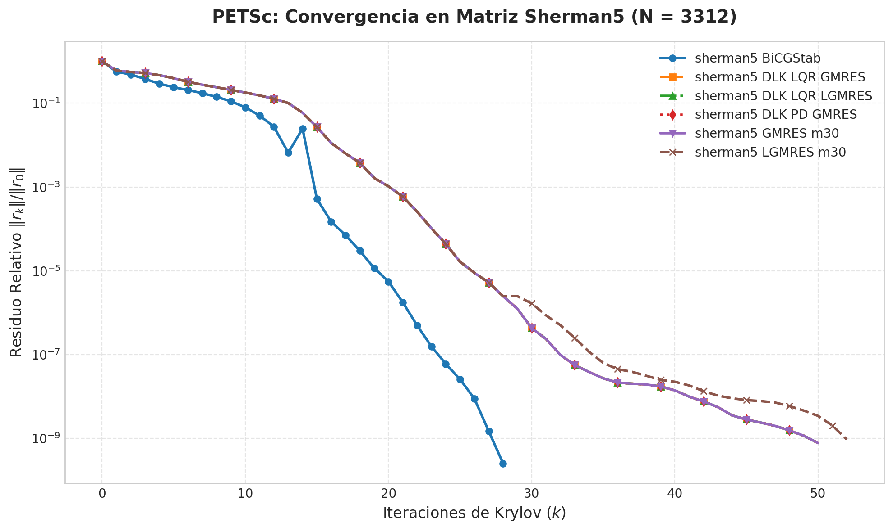

# Resultados del Benchmark: Matriz Sherman5

Este informe presenta los resultados obtenidos al resolver el sistema lineal de la matriz **`sherman5.mat`** de la colección **SuiteSparse** utilizando los solvers adaptativos **`KSPDLK`** y **`KSPDLKLGMRES`** en comparación con los baselines nativos de PETSc.

---

## 1. Características del Problema

* **Matriz:** `sherman5.mat` (SuiteSparse Matrix Collection)
* **Origen:** Simulación de yacimientos petrolíferos (Black Oil Model)
* **Dimensión:** $N = 3312 \times 3312$
* **Elementos no nulos (nnz):** $20\,793$
* **Simetría:** No simétrica
* **Tolerancia relativa:** $10^{-9}$
* **Precondicionador:** ILU(0) de PETSc

---

## 2. Tabla de Resultados de Rendimiento

| Configuración del Solver (KSP) | Algoritmo / Control | Precondicionador | Iteraciones Totales | Residuo Final $\|b - Ax\|_2$ | Tiempo de Ejecución (s) |
| :--- | :--- | :---: | :---: | :---: | :---: |
| **DLK-LQR-LGMRES** | LGMRES Adaptativo ($\ell = 2, m_0 = 30$) | ILU(0) | **50** | $1.2623 \times 10^{-6}$ | 0.0111 s |
| **DLK-LQR-GMRES** | GMRES Adaptativo ($m_0 = 30$) | ILU(0) | **50** | $1.2623 \times 10^{-6}$ | 0.0097 s |
| **DLK-PD-GMRES** | GMRES con Control PD ($m_0 = 30$) | ILU(0) | **50** | $1.2623 \times 10^{-6}$ | 0.0092 s |
| **LGMRES Nativo** | Fijo ($m = 30, \ell = 2$) | ILU(0) | 51 | $1.5987 \times 10^{-6}$ | 0.0088 s |
| **GMRES Nativo** | Fijo ($m = 30$) | ILU(0) | 50 | $1.2623 \times 10^{-6}$ | 0.0102 s |
| **BiCGStab** | Baseline Krylov | ILU(0) | 28 | $1.2425 \times 10^{-7}$ | 0.0060 s |

---

## 3. Gráfica de Convergencia

La evolución de la norma del residuo relativo ($\|r_k\|_2 / \|r_0\|_2$) iteración a iteración se encuentra guardada en alta resolución en:

*(Ruta local: `results/sherman5_convergence.png`)*

---

## 4. Archivos de Datos Generados en `results/`

* `results/history_sherman5_DLK_LQR_LGMRES.csv`
* `results/history_sherman5_DLK_LQR_GMRES.csv`
* `results/history_sherman5_DLK_PD_GMRES.csv`
* `results/history_sherman5_LGMRES_m30.csv`
* `results/history_sherman5_GMRES_m30.csv`
* `results/history_sherman5_BiCGStab.csv`
* `results/sherman5_convergence.png`
* `results/sherman5_results.md`
